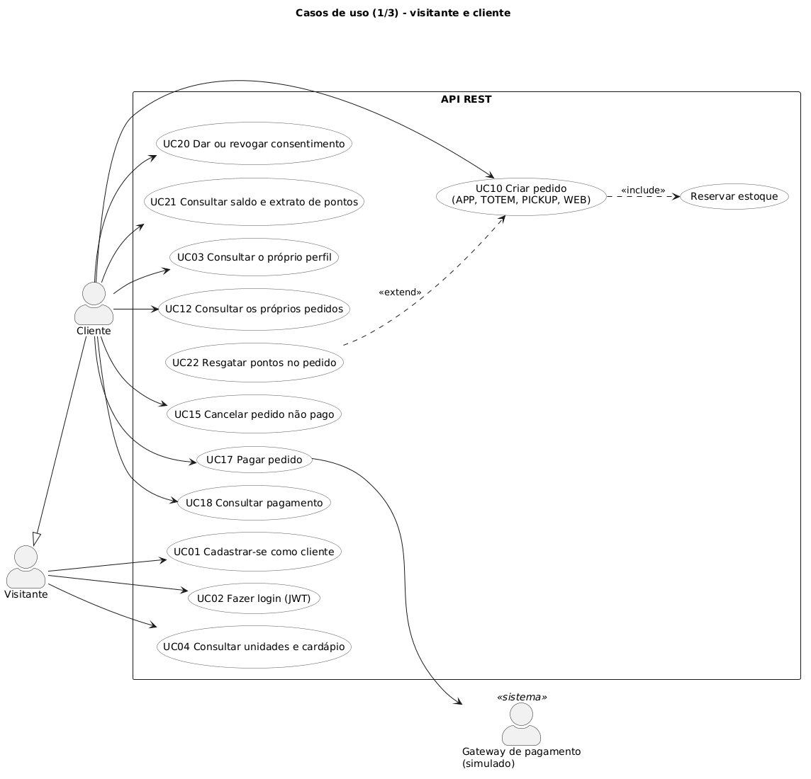
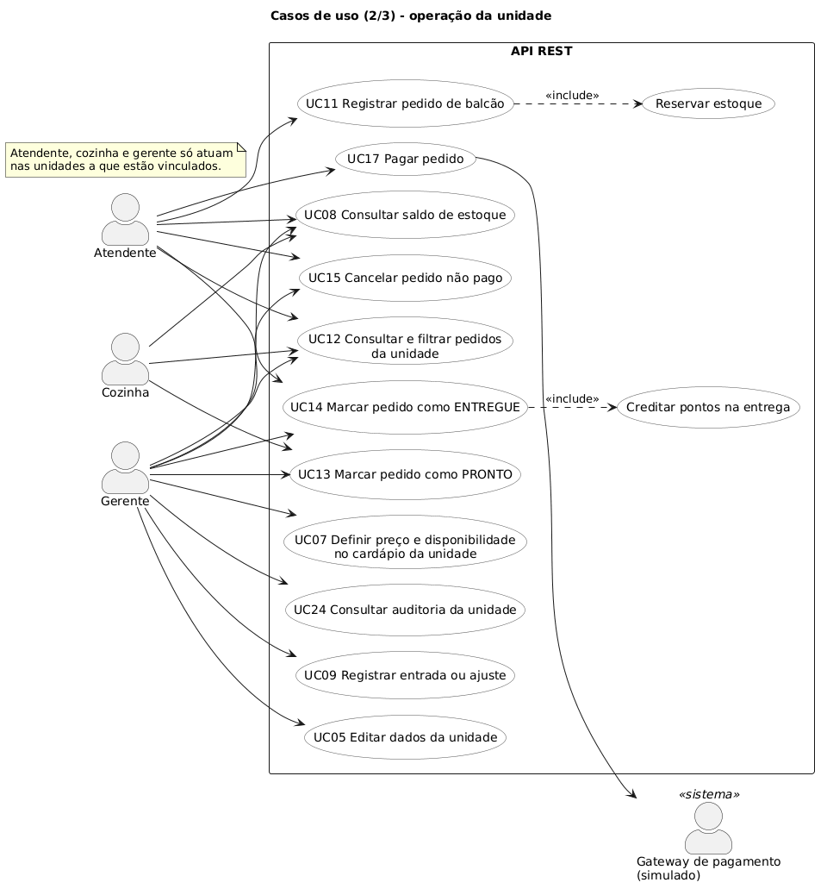
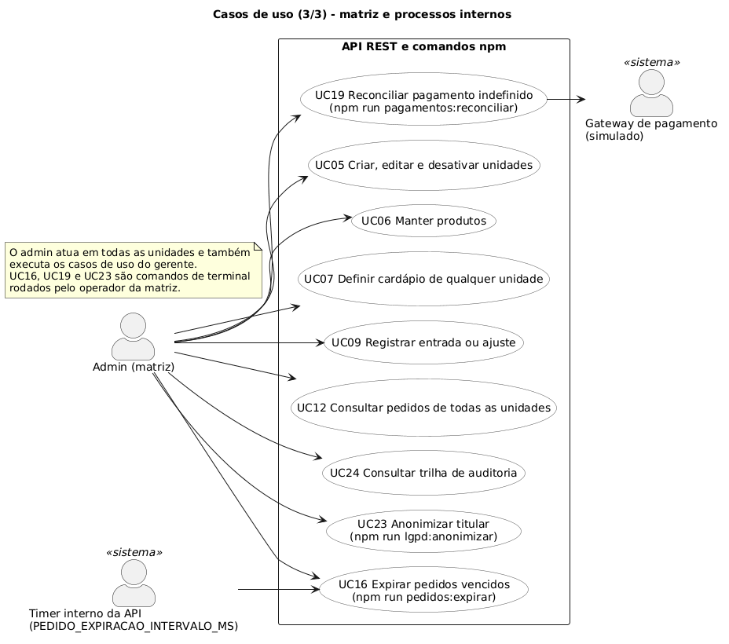
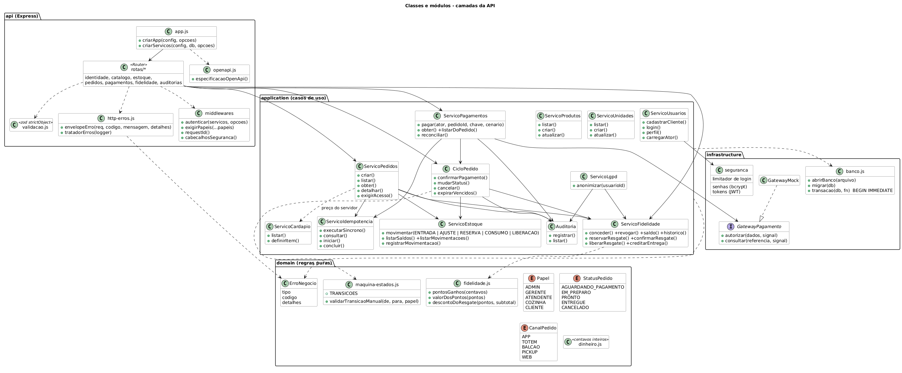
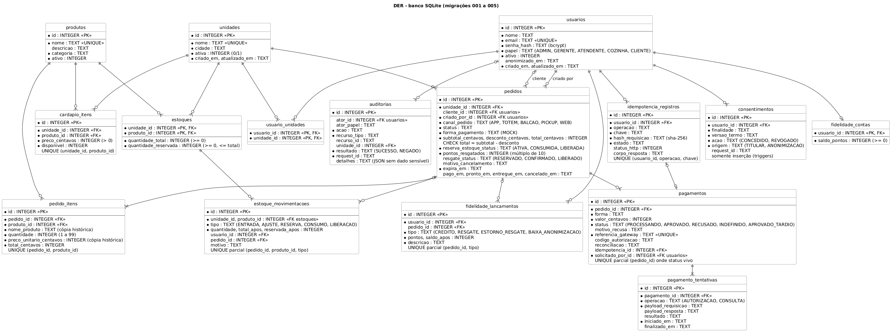
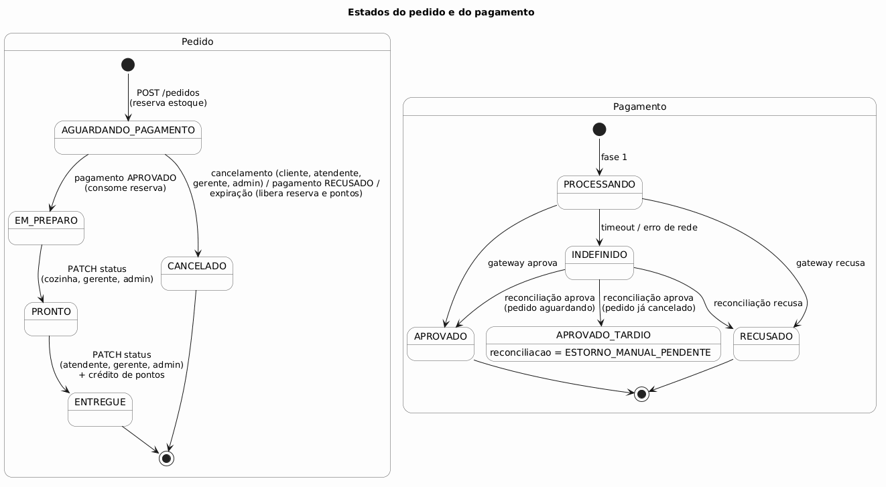
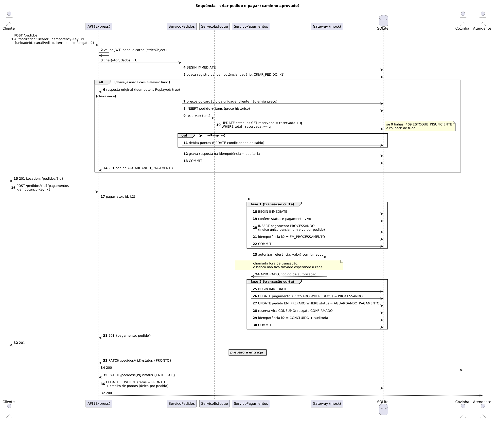
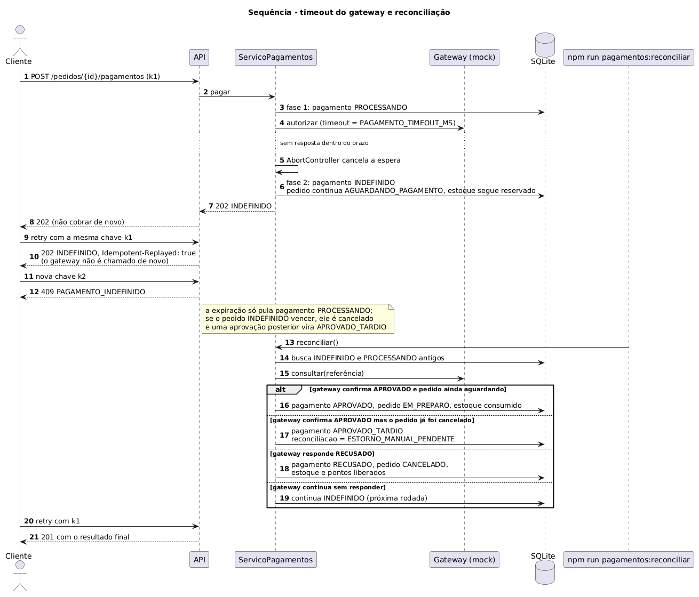

<div class="capa">

<p class="capa-topo">Centro Universitário Internacional UNINTER<br>Análise e Desenvolvimento de Sistemas<br>Projeto Back-End</p>

<p class="capa-autor">Hermes Gabriel Santos Crispim<br>RU: 4307859</p>

<p class="capa-titulo">PROJETO BACK-END: API PARA UMA REDE DE RESTAURANTES</p>

<p class="capa-rodape">Uninter - Montes Claros – MG<br>2026</p>

</div>

<div class="sumario">

## Sumário {.sem-numero}

1. Introdução e objetivos
2. Requisitos e prioridades
3. Modelagem e arquitetura
4. API e funcionalidades críticas
5. Política de falha de pagamento
6. Privacidade, segurança e auditoria
7. Entrega técnica
8. Plano de testes e resultados
9. Conclusão

Apêndice A. Matriz de rastreabilidade

Apêndice B. Regra de promoção (proposta)

Apêndice C. Evidência: testes automatizados

Apêndice D. Evidência: coleção Postman (newman)

Apêndice E. Declaração de uso de inteligência artificial

</div>

## 1. Introdução e objetivos

Este trabalho apresenta o back-end de uma rede de restaurantes com uma matriz e várias unidades. Os pedidos chegam por cinco canais: aplicativo (APP), totem de autoatendimento (TOTEM), balcão (BALCAO), retirada (PICKUP) e site (WEB). Os atores são o cliente, o atendente de balcão, a cozinha, o gerente ou administrador e o gateway de pagamento, que é um sistema externo. Não há interface gráfica. A API é usada pelo Swagger UI ou pela coleção Postman.

O objetivo foi:

- implementar por completo o fluxo pedido → pagamento → preparo → entrega, com os módulos de que ele depende: identidade, unidades, produtos, cardápio por unidade e estoque por unidade;
- implementar um programa de fidelidade simples, com consentimento;
- documentar uma regra de promoção e o estorno depois do pagamento como **propostas**, sem endpoint;
- garantir as regras que envolvem dinheiro e concorrência: não vender acima do estoque, não cobrar duas vezes e não creditar pontos duas vezes;
- tratar dados pessoais de acordo com a LGPD: coleta mínima, consentimento, auditoria e anonimização.

Ao longo do relatório, cada funcionalidade aparece como **Implementada** (existe código e teste passando) ou **Proposta** (existe só documentação). Este documento reúne toda a documentação do projeto: a matriz de rastreabilidade, o plano de testes, as evidências de execução e a declaração de uso de IA estão nos apêndices. Repositório: https://github.com/hermesgsc/restaurant-api. Coleção Postman: https://github.com/hermesgsc/restaurant-api/blob/main/postman/rede-restaurantes.postman_collection.json.

## 2. Requisitos e prioridades

Esta seção resume os requisitos. A matriz completa, que liga cada requisito ao caso de uso, às entidades, aos endpoints, aos testes e às requisições do Postman, está no Apêndice A.

### 2.1 Prioridades

| Prioridade | Escopo | Motivo técnico |
|---|---|---|
| P1 | Pedido → pagamento → preparo → entrega | É o único fluxo que o enunciado exige completo. Ele depende de identidade, cardápio e estoque, e é onde estão os riscos de dinheiro e de concorrência (venda acima do estoque, cobrança duplicada). Foi feito primeiro, com banco real e testes de concorrência. |
| P2 | Identidade, unidades, produtos, cardápio, estoque manual, auditoria e LGPD | Sem esses módulos o P1 não roda (preço, papel, escopo de unidade) ou não pode ser verificado (auditoria). A anonimização entra aqui porque o enunciado pede demonstração com teste. |
| P3 | Fidelidade | Depende de a entrega e o cancelamento já estarem corretos, porque o crédito é na entrega e a devolução do resgate é no cancelamento. |
| P4 | Promoção e estorno depois do pagamento | O enunciado aceita só documentação. Implementar estorno sem gateway real seria criar um estorno falso. |

### 2.2 Requisitos funcionais

| ID | Requisito | Status |
|---|---|---|
| RF01 | Cadastro de cliente (sempre CLIENTE) e autenticação; seed com todos os papéis | Implementado |
| RF02 | Unidades e produtos com ativação e desativação; cardápio por unidade com preço e disponibilidade | Implementado |
| RF03 | Pedido com `unidadeId`, `canalPedido`, itens e `formaPagamento=MOCK`; cliente vem do token; venda de balcão sem cliente | Implementado |
| RF04 | `canalPedido` em APP, TOTEM, BALCAO, PICKUP e WEB, gravado, devolvido e usado como filtro | Implementado |
| RF05 | Preço do cardápio, total calculado no servidor, preço histórico, centavos inteiros | Implementado |
| RF06 | Estoque independente por unidade, com movimentações e sem saldo negativo sob concorrência | Implementado |
| RF07 | Máquina de estados do pedido; recusa cancela o pedido e guarda o motivo; transição inválida dá 409 | Implementado |
| RF08 | Pagamento por interface com adaptador mock: aprovação, recusa e timeout determinísticos | Implementado |
| RF09 | Reserva na criação, consumo na aprovação, liberação na recusa ou cancelamento; expiração em 15 minutos | Implementado |
| RF10 | Cancelamento só antes do pagamento; corridas resolvidas no banco | Implementado |
| RF10.1 | Estorno de pedido já pago | **Proposto** (seção 5.6) |
| RF11 | `Idempotency-Key` em pedido e pagamento; nada é cobrado, consumido ou creditado duas vezes | Implementado |
| RF12 | Fidelidade: consentimento, saldo, extrato, crédito na entrega e resgate | Implementado |
| RF13 | Regra de promoção com ordem de cálculo e exemplos | **Proposto** (Apêndice B) |

Os requisitos técnicos (RT01 a RT12), de segurança (RS01 a RS06) e de LGPD (RL01 a RL04) estão no Apêndice A, todos com status Implementado. O apêndice também tem uma tabela com a decisão e o teste de cada caso de borda pedido no enunciado.

### 2.3 Premissas

- Estoque por produto, sem ficha técnica nem ingredientes.
- Pedido não pago expira em 15 minutos (`PEDIDO_EXPIRACAO_MINUTOS`).
- Fidelidade: 1 ponto por real inteiro do total pago, creditado quando o pedido fica ENTREGUE; resgate em múltiplos de 10 pontos (10 pontos = R$ 1,00), limitado ao subtotal.
- Produto repetido em duas linhas do pedido é **rejeitado** com 422 `PRODUTO_REPETIDO`, e não somado.
- A recusa de pagamento é um resultado de negócio, e não um erro de transporte: a resposta é 201 com o pagamento `RECUSADO`.
- As bases legais e os prazos de retenção são premissas de projeto, não pareceres jurídicos.

## 3. Modelagem e arquitetura

### 3.1 Casos de uso

Os casos de uso estão divididos em três diagramas: o cliente; a operação da unidade (atendente, cozinha e gerente); e a matriz (administrador). O gateway de pagamento aparece como ator externo nos fluxos de pagamento.

{.meia}

{.meia}

{.meia}

### 3.2 Arquitetura em camadas

O sistema é um monólito modular com quatro camadas:

| Camada | Pasta | Responsabilidade |
|---|---|---|
| Domain | `src/domain` | Regras puras: máquina de estados, cálculo de estoque, pontos e dinheiro, papéis. Sem HTTP e sem banco. |
| Application | `src/application` | Casos de uso: criar pedido, pagar, cancelar, expirar, reconciliar, anonimizar. Abre as transações. |
| Infrastructure | `src/infrastructure` | SQLite, repositórios, hash de senha, JWT, gateway de pagamento (contrato e mock), seed. |
| API | `src/api` | Rotas Express, validação com zod, autenticação, envelope de erro, OpenAPI. |

O provedor de pagamento fica atrás do contrato `src/infrastructure/pagamento/gateway.js`. O `gateway-mock.js` é a única implementação. Trocar por um gateway real seria escrever outro adaptador com o mesmo contrato.

{.paisagem}

### 3.3 Modelo de dados

O banco tem 16 tabelas, criadas pelas migrações `001` a `005`, com 21 índices e 2 triggers. O DER mostra as chaves primárias e estrangeiras, as cardinalidades e as restrições.

{.paisagem}

Restrições que garantem as regras de negócio no próprio banco:

- `estoques`: `CHECK (quantidade_reservada <= quantidade_total)` e saldos não negativos;
- `pedidos`: `CHECK` do canal e do status, e `total = subtotal − desconto`;
- `estoque_movimentacoes`: índice único por pedido, produto e tipo, para que a reserva ou o consumo de um pedido não sejam gravados duas vezes;
- `pagamentos`: índice único parcial que permite só um pagamento "vivo" por pedido;
- `fidelidade_lancamentos`: índice único por pedido e tipo, para que o crédito de um pedido não seja lançado duas vezes;
- `idempotencia_registros`: único por usuário, operação e chave;
- `consentimentos`: triggers que bloqueiam UPDATE e DELETE, então o histórico só cresce.

### 3.4 Papéis e escopo

As regras desta seção foram tiradas de `src/domain/papeis.js`, `src/domain/maquina-estados.js`, dos serviços em `src/application/` e das rotas em `src/api/rotas/`.

| Papel | Quem representa | Escopo |
|---|---|---|
| ADMIN | Matriz | Toda a rede. `temEscopoUnidade` sempre devolve verdadeiro para ADMIN |
| GERENTE | Gerente de unidade | Só as unidades vinculadas em `usuario_unidades` |
| ATENDENTE | Atendente de balcão | Só as unidades vinculadas |
| COZINHA | Equipe de preparo | Só as unidades vinculadas |
| CLIENTE | Consumidor | Só os próprios pedidos, pagamentos e pontos |
| Gateway de pagamento | Sistema externo | Não chama a API. É chamado por ela, pelo contrato em `src/infrastructure/pagamento/gateway.js` |
| Sistema | Timer de expiração e comandos `npm run` | Expiração, reconciliação e anonimização. A auditoria grava `ator_id` nulo e um `request_id` fixo (`expiracao-automatica`, `reconciliacao`, `lgpd-comando-<instante>`) |

Papel e unidades são lidos do banco a cada requisição (`carregarAtor`), e não do token nem do corpo. Usuário desativado ou anonimizado perde o acesso na hora, mesmo com token ainda dentro da validade.

**Matriz de permissões por endpoint.** Legenda: **S** permitido; **U** permitido só nas unidades vinculadas; **P** permitido só nos recursos próprios; **—** negado (403, ou 401 sem token); **Púb.** não exige token.

| Endpoint | Anônimo | CLIENTE | ATENDENTE | COZINHA | GERENTE | ADMIN |
|---|---|---|---|---|---|---|
| `GET /health` | Púb. | S | S | S | S | S |
| `POST /usuarios` (cadastro, sempre CLIENTE) | Púb. | S | S | S | S | S |
| `POST /auth/login` | Púb. | S | S | S | S | S |
| `GET /usuarios/me` | — | P | P | P | P | P |
| `GET /unidades` | Púb. (só ativas) | S (só ativas) | S (só ativas) | S (só ativas) | S (inclui inativas) | S (inclui inativas) |
| `POST /unidades` | — | — | — | — | — | S |
| `PATCH /unidades/{id}` (nome, cidade) | — | — | — | — | U | S |
| `PATCH /unidades/{id}` (`ativa`) | — | — | — | — | — | S |
| `GET /unidades/{id}/cardapio` | Púb. (itens vendáveis de unidade ativa) | S | S | S | U (com `incluirIndisponiveis`) | S (com `incluirIndisponiveis`) |
| `PUT /unidades/{id}/cardapio/{produtoId}` | — | — | — | — | U | S |
| `GET /produtos` | Púb. (só ativos) | S (só ativos) | S (inclui inativos) | S (inclui inativos) | S (inclui inativos) | S (inclui inativos) |
| `POST /produtos`, `PATCH /produtos/{id}` | — | — | — | — | — | S |
| `GET /estoque` | — | — | U | U | U | S |
| `GET /estoque/movimentacoes` | — | — | — | — | U | S |
| `POST /estoque/movimentacoes` (ENTRADA, AJUSTE) | — | — | — | — | U | S |
| `POST /pedidos` | — | P (APP, TOTEM, PICKUP, WEB) | U (todos os canais, com ou sem cliente) | — | U | S |
| `GET /pedidos`, `GET /pedidos/{id}` | — | P | U | U | U | S |
| `PATCH /pedidos/{id}/status` → PRONTO | — | — | — | U | U | S |
| `PATCH /pedidos/{id}/status` → ENTREGUE | — | — | U | — | U | S |
| `POST /pedidos/{id}/cancelamentos` | — | P | U | — | U | S |
| `POST /pedidos/{id}/pagamentos` | — | P | U | — | U | S |
| `GET /pedidos/{id}/pagamentos`, `GET /pagamentos/{id}` | — | P | U | U | U | S |
| `GET /fidelidade/saldo`, `GET /fidelidade/historico` | — | P | — | — | — | — |
| `PUT /fidelidade/consentimento`, `DELETE /fidelidade/consentimento` | — | P | — | — | — | — |
| `pontosResgatar` em `POST /pedidos` | — | P | — | — | — | — |
| `GET /auditorias` | — | — | — | — | U (nunca vê registros sem unidade) | S |

Os comandos `npm run lgpd:anonimizar`, `pedidos:expirar` e `pagamentos:reconciliar` ficam fora da API e são executados por um operador com acesso ao servidor. Toda negação de acesso a um pedido de outra pessoa ou de outra unidade gera auditoria `PEDIDO_ACESSO_NEGADO` com resultado `NEGADO`. O ADMIN não participa da fidelidade: o programa é só para CLIENTE (`exigirCliente`). Não existe endpoint para criar funcionários. Eles vêm do seed, e a criação de funcionários com vínculo a unidades fica para uma versão futura com tela de administração.

### 3.5 Estados do pedido

{.largura}

| Estado | Significado | Reserva de estoque | Entra por | Sai para |
|---|---|---|---|---|
| `AGUARDANDO_PAGAMENTO` | Criado, com estoque reservado, esperando pagamento por até 15 minutos | `ATIVA` | `POST /pedidos` | `EM_PREPARO`, `CANCELADO` |
| `EM_PREPARO` | Pago; a cozinha pode preparar | `CONSUMIDA` | Pagamento aprovado (na resposta original ou na reconciliação) | `PRONTO` |
| `PRONTO` | Preparado, esperando retirada ou entrega | `CONSUMIDA` | `PATCH /status` | `ENTREGUE` |
| `ENTREGUE` | Entregue ao cliente; estado final; credita pontos | `CONSUMIDA` | `PATCH /status` | — |
| `CANCELADO` | Cancelado antes do pagamento; estado final | `LIBERADA` | Cancelamento, recusa ou expiração | — |

| De | Para | Via | Quem | Condição | Efeitos | Erro se não puder |
|---|---|---|---|---|---|---|
| — | `AGUARDANDO_PAGAMENTO` | `POST /pedidos` | CLIENTE, ATENDENTE, GERENTE, ADMIN | Unidade ativa, itens vendáveis, estoque e pontos suficientes | Reserva (`RESERVA`); débito do resgate; `expira_em` | 404, 409, 422 (seção 4.4) |
| `AGUARDANDO_PAGAMENTO` | `EM_PREPARO` | Pagamento aprovado | Gateway (pela API) | Pedido ainda aguardando, reserva `ATIVA` | `CONSUMO`; resgate `CONFIRMADO`; `pago_em` | Se o pedido já mudou, o pagamento vira `APROVADO_TARDIO` |
| `AGUARDANDO_PAGAMENTO` | `CANCELADO` | `POST /pedidos/{id}/cancelamentos` | CLIENTE dono, ATENDENTE, GERENTE, ADMIN | Sem pagamento `PROCESSANDO` | `LIBERACAO`; `ESTORNO_RESGATE`; motivo `SOLICITADO` | 409 `PEDIDO_JA_CANCELADO`, `CANCELAMENTO_APOS_PAGAMENTO`, `PAGAMENTO_EM_ANDAMENTO`; 403 para COZINHA |
| `AGUARDANDO_PAGAMENTO` | `CANCELADO` | Pagamento recusado | Gateway (pela API) | — | Iguais ao cancelamento; motivo `PAGAMENTO_RECUSADO: <motivo>` | — |
| `AGUARDANDO_PAGAMENTO` | `CANCELADO` | Expiração | Sistema | `expira_em <= agora` e sem pagamento `PROCESSANDO` | Iguais ao cancelamento; motivo `EXPIRADO` | — (pedido com pagamento em processamento é pulado) |
| `EM_PREPARO` | `PRONTO` | `PATCH /pedidos/{id}/status` | COZINHA, GERENTE, ADMIN da unidade | — | `pronto_em` | 403 para outro papel; 409 `TRANSICAO_INVALIDA` |
| `PRONTO` | `ENTREGUE` | `PATCH /pedidos/{id}/status` | ATENDENTE, GERENTE, ADMIN da unidade | — | `entregue_em`; crédito de pontos | 403 para outro papel; 409 `TRANSICAO_INVALIDA` |

Qualquer outra combinação (pular etapa, voltar, repetir `ENTREGUE`, mexer em pedido cancelado) dá 409 `TRANSICAO_INVALIDA`, com o próximo status válido em `details`. O `PATCH /status` só aceita `PRONTO` ou `ENTREGUE` no corpo; qualquer outro valor dá 422 antes de chegar à máquina de estados. Toda transição é um `UPDATE pedidos ... WHERE id = ? AND status = <estado esperado>`. Se pagamento, cancelamento e expiração correrem juntos, só o primeiro muda a linha; os outros veem `changes = 0` e não aplicam efeitos.

### 3.6 Estados do pagamento

| Estado | Significado | Final? | HTTP em `POST /pagamentos` | Pedido |
|---|---|---|---|---|
| `PROCESSANDO` | Intenção gravada; gateway sendo chamado | Não | (não é devolvido; existe só entre as fases) | `AGUARDANDO_PAGAMENTO` |
| `APROVADO` | Gateway aprovou e o pedido foi confirmado | Sim | 201 | `EM_PREPARO` |
| `RECUSADO` | Gateway recusou; `motivo_recusa` obrigatório | Sim | 201 | `CANCELADO` |
| `INDEFINIDO` | Timeout ou falha de comunicação; resultado desconhecido | Não | 202 | `AGUARDANDO_PAGAMENTO` (reserva mantida) |
| `APROVADO_TARDIO` | Gateway aprovou depois que o pedido já estava cancelado ou expirado; `reconciliacao = ESTORNO_MANUAL_PENDENTE` | Sim | 201 | `CANCELADO` (não volta) |

| De | Para | Quando |
|---|---|---|
| — | `PROCESSANDO` | Fase 1 do `POST /pedidos/{id}/pagamentos` |
| `PROCESSANDO` | `APROVADO` | Gateway aprova e o pedido ainda estava aguardando |
| `PROCESSANDO` | `APROVADO_TARDIO` | Gateway aprova, mas o pedido já foi cancelado ou expirou |
| `PROCESSANDO` | `RECUSADO` | Gateway recusa |
| `PROCESSANDO` | `INDEFINIDO` | Timeout ou erro de comunicação |
| `INDEFINIDO` | `APROVADO`, `APROVADO_TARDIO`, `RECUSADO` | Reconciliação recebe uma resposta |
| `INDEFINIDO` | `INDEFINIDO` | Reconciliação sem resposta; só `atualizado_em` muda |
| `PROCESSANDO` parado | qualquer um acima | Reconciliação de pagamento parado há mais de 2 × `PAGAMENTO_TIMEOUT_MS` |

Restrições no banco (`migrations/004`): `ux_pagamento_vivo_por_pedido` permite no máximo um pagamento `PROCESSANDO`, `INDEFINIDO` ou `APROVADO` por pedido; `CHECK (status <> 'RECUSADO' OR motivo_recusa IS NOT NULL)`; e `CHECK ((status = 'APROVADO_TARDIO') = (reconciliacao IS NOT NULL))`.

Estados auxiliares:

| Campo | Valores | Regra |
|---|---|---|
| `pedidos.reserva_estoque_status` | `ATIVA` → `CONSUMIDA` (pagamento) ou `LIBERADA` (cancelamento) | A troca é condicionada a `ATIVA`, então o estoque nunca é consumido ou liberado duas vezes |
| `pedidos.resgate_status` | nulo (sem resgate), `RESERVADO` → `CONFIRMADO` ou `LIBERADO` | A devolução dos pontos só acontece na troca `RESERVADO` → `LIBERADO` |
| `idempotencia_registros.estado` | `EM_PROCESSAMENTO` → `CONCLUIDO` | A conclusão é condicionada a `EM_PROCESSAMENTO` |
| `consentimentos.acao` | `CONCEDIDO`, `REVOGADO` (só inserção; o estado atual é a última linha) | Triggers bloqueiam UPDATE e DELETE |

### 3.7 Sequência: pedido e pagamento

O pagamento acontece em duas fases, para não deixar transação aberta durante a chamada ao gateway:

1. Numa transação curta, grava o pagamento `PROCESSANDO` e a tentativa.
2. Fora de transação, chama o gateway com tempo máximo `PAGAMENTO_TIMEOUT_MS`.
3. Numa nova transação, finaliza com `UPDATE pagamentos ... WHERE id = ? AND status = ?`, repetindo o status lido. A confirmação do pedido também é condicionada (`WHERE status = 'AGUARDANDO_PAGAMENTO'`), então só uma finalização aplica os efeitos (consumo de estoque, mudança do pedido, pontos).

{.paisagem}

Quando o gateway não responde a tempo, o pagamento fica `INDEFINIDO` e a resposta é 202. O comando `npm run pagamentos:reconciliar` consulta o gateway depois e aplica o resultado pela mesma função de finalização. Se a aprovação chegar depois de o pedido ter sido cancelado ou ter expirado, o pagamento vira `APROVADO_TARDIO` com `reconciliacao = ESTORNO_MANUAL_PENDENTE`, e o pedido continua cancelado.

{.meia}

### 3.8 Concorrência

Toda escrita que disputa recurso usa `BEGIN IMMEDIATE`, que pega o bloqueio de escrita do SQLite no início da transação, e um UPDATE condicionado. No estoque, a transação lê o saldo, o domínio calcula o novo saldo e recusa a reserva se faltar disponível, e o UPDATE só grava se a linha ainda tiver os valores lidos:

```sql
UPDATE estoques SET quantidade_total = ?, quantidade_reservada = ?, atualizado_em = ?
 WHERE unidade_id = ? AND produto_id = ?
   AND quantidade_total = ? AND quantidade_reservada = ?
```

Se faltar saldo em algum item, o pedido inteiro é desfeito com 409 `ESTOQUE_INSUFICIENTE`. O `CHECK (quantidade_reservada <= quantidade_total)` confere de novo no banco. O mesmo padrão de UPDATE com `WHERE status = ...` vale para a finalização do pagamento, as transições de status, o cancelamento e os pontos. O teste com 8 conexões disputando 1 unidade de estoque mostra que só uma reserva passa.

## 4. API e funcionalidades críticas

### 4.1 Endpoints

A especificação OpenAPI 3 fica em `src/api/openapi.js` e é servida em `GET /openapi.json`, com o Swagger UI em `/docs` e autenticação bearer configurada. Uma cópia fica em `docs/openapi.json`. Um teste automatizado compara as rotas registradas no Express com as documentadas e falha se alguma faltar de um dos lados. Cada operação tem finalidade, papéis, parâmetros, exemplos de requisição e de resposta, e os códigos de status.

| Método | Rota | Uso |
|---|---|---|
| GET | `/health` | Verifica se a API está no ar |
| POST | `/usuarios` | Cadastro público de cliente |
| POST | `/auth/login` | Login, devolve o token |
| GET | `/usuarios/me` | Dados do usuário autenticado |
| GET, POST | `/unidades` | Lista e cria unidades (criar: ADMIN) |
| PATCH | `/unidades/{id}` | Altera unidade |
| GET | `/unidades/{id}/cardapio` | Cardápio da unidade com preços |
| PUT | `/unidades/{id}/cardapio/{produtoId}` | Inclui ou altera item do cardápio |
| GET, POST | `/produtos` | Catálogo da rede (criar: ADMIN) |
| PATCH | `/produtos/{id}` | Altera ou desativa produto |
| GET | `/estoque` | Saldos da unidade |
| GET, POST | `/estoque/movimentacoes` | Histórico, entrada e ajuste |
| POST, GET | `/pedidos` | Cria pedido; lista com filtros de canal, status e unidade |
| GET | `/pedidos/{id}` | Detalha pedido |
| PATCH | `/pedidos/{id}/status` | Avança o preparo |
| POST | `/pedidos/{id}/cancelamentos` | Cancela pedido não pago |
| POST, GET | `/pedidos/{id}/pagamentos` | Paga no gateway simulado; lista pagamentos |
| GET | `/pagamentos/{id}` | Pagamento com as tentativas |
| GET | `/fidelidade/saldo`, `/fidelidade/historico` | Saldo e extrato de pontos |
| PUT, DELETE | `/fidelidade/consentimento` | Aceita e revoga o consentimento |
| GET | `/auditorias` | Trilha de auditoria (ADMIN; GERENTE das próprias unidades) |

São 22 caminhos e 28 operações. As rotas usam recursos no plural, com `/auth/login` como exceção. As listas são paginadas com `page` e `limit` (máximo 100).

### 4.2 Exemplo: criar pedido

```http
POST /pedidos
Authorization: Bearer <token>
Idempotency-Key: 6f1c2a90-pedido-001

{
  "unidadeId": 1,
  "canalPedido": "APP",
  "itens": [{ "produtoId": 1, "quantidade": 2 }],
  "formaPagamento": "MOCK"
}
```

A resposta é 201, com o total calculado pelo servidor (`subtotalCentavos`, `descontoCentavos`, `totalCentavos`), o canal gravado, o preço de cada item copiado do cardápio e o status `AGUARDANDO_PAGAMENTO`. Repetir a mesma requisição com a mesma chave devolve o mesmo pedido, com o cabeçalho `Idempotent-Replayed: true`. Usar a mesma chave com outro corpo dá 409.

### 4.3 Envelope de erro

Todo erro, inclusive JSON malformado, corpo grande demais e erro inesperado, usa o mesmo formato:

```json
{
  "error": "ESTOQUE_INSUFICIENTE",
  "message": "Estoque insuficiente para um dos itens.",
  "details": [{ "field": "itens[0].quantidade", "issue": "Disponivel: 1" }],
  "timestamp": "2026-10-28T17:57:17.435Z",
  "path": "/pedidos",
  "requestId": "b3f0c1e2-..."
}
```

O `timestamp` e o `requestId` são gerados em cada resposta. O `requestId` também volta no cabeçalho `X-Request-Id` e aparece no log e na auditoria. Os status usados são 200, 201, 202, 204, 400, 401, 403, 404, 409, 413, 422, 429 e 500. As mensagens da API são sem acento de propósito. Nas seções a seguir, os códigos de erro aparecem como estão no campo `error` do envelope.

As seções 4.4 a 4.11 descrevem as oito funcionalidades em que um erro custa dinheiro ou estoque. Cada uma tem pré-condições, pós-condições, fluxo principal e fluxos alternativos, conferidos no código atual (`src/application/`).

### 4.4 Criar pedido

`POST /pedidos` — `src/application/pedidos.js` (`criar`, `inserirPedido`, `precificar`)

| Item | Descrição |
|---|---|
| Atores | CLIENTE (APP, TOTEM, PICKUP, WEB) e ATENDENTE, GERENTE ou ADMIN (qualquer canal, inclusive BALCAO), sempre numa unidade do próprio escopo |
| Pré-condições | Token válido de usuário ativo; cabeçalho `Idempotency-Key` com 8 a 100 caracteres; unidade existente e ativa; todos os produtos ativos, no cardápio da unidade e disponíveis; estoque disponível (`total − reservado`) suficiente para cada item |
| Entrada | `unidadeId`, `canalPedido` (APP, TOTEM, BALCAO, PICKUP, WEB), `formaPagamento` = `MOCK`, `itens` (1 a 20 linhas, `produtoId` e `quantidade` inteira de 1 a 99), `clienteId` opcional (só funcionário), `pontosResgatar` opcional (só cliente) |
| Pós-condições | Pedido em `AGUARDANDO_PAGAMENTO` com `reserva_estoque_status = ATIVA`, `expira_em` = criação + 15 minutos; itens com nome e preço copiados do cardápio; uma movimentação `RESERVA` por item; auditoria `PEDIDO_CRIADO`; registro de idempotência `CONCLUIDO` com a resposta 201 |

**Fluxo principal**

1. A rota valida o corpo com `z.strictObject`. Campos não previstos, como `precoCentavos`, `totalCentavos` ou `status`, são rejeitados.
2. O serviço abre uma transação `BEGIN IMMEDIATE` e procura a chave de idempotência do usuário para a operação `CRIAR_PEDIDO`.
3. Confere a unidade, a permissão do papel no canal e na unidade, e se a unidade está ativa.
4. Resolve o cliente: para o CLIENTE vem do token; para o funcionário vem do `clienteId` informado, ou fica vazio (venda de balcão sem cliente).
5. Busca o preço de cada item no cardápio da unidade e calcula o subtotal em centavos inteiros.
6. Grava o pedido e os itens e reserva o estoque item a item (seção 4.7).
7. Se houver `pontosResgatar`, debita os pontos e grava o desconto (seção 4.11).
8. Grava a auditoria e a resposta de idempotência, faz o COMMIT e responde 201.

**Fluxos alternativos**

| Situação | Resultado |
|---|---|
| Mesma chave e mesmo corpo | Devolve a resposta original, com `Idempotent-Replayed: true` e sem reservar de novo (seção 4.6) |
| Mesma chave e outro corpo | 409 `IDEMPOTENCY_KEY_REUTILIZADA` |
| Sem `Idempotency-Key` ou com formato inválido | 422 `IDEMPOTENCY_KEY_INVALIDA` |
| Canal ausente ou fora da lista, itens vazios, quantidade 0, negativa ou fracionada | 422 `VALIDACAO` |
| Mesmo produto em duas linhas | 422 `PRODUTO_REPETIDO` (não é somado) |
| Unidade ou produto inexistente | 404 `UNIDADE_NAO_ENCONTRADA` / `PRODUTO_NAO_ENCONTRADO` |
| Produto fora do cardápio, inativo ou indisponível; unidade inativa | 409 `PRODUTO_FORA_DO_CARDAPIO` / `PRODUTO_INDISPONIVEL` / `UNIDADE_INATIVA` |
| Cliente usando BALCAO ou pedindo em nome de outro | 403 `ACESSO_NEGADO` |
| Funcionário de outra unidade, ou COZINHA | 403 `ACESSO_NEGADO` |
| `clienteId` que não é cliente ativo | 404 `CLIENTE_NAO_ENCONTRADO` |
| Estoque insuficiente | 409 `ESTOQUE_INSUFICIENTE` (seção 4.7) |

### 4.5 Pagar pedido

`POST /pedidos/{id}/pagamentos` — `src/application/pagamentos.js` (`pagar`, `registrarIntencao`, `chamarGateway`, `finalizar`)

| Item | Descrição |
|---|---|
| Atores | CLIENTE dono do pedido; ATENDENTE ou GERENTE da unidade; ADMIN. A COZINHA não paga |
| Pré-condições | Pedido em `AGUARDANDO_PAGAMENTO` e não vencido; nenhum pagamento `PROCESSANDO` ou `INDEFINIDO` para o pedido; `Idempotency-Key` válida; corpo vazio (o valor vem do pedido) |
| Pós-condições (aprovado) | Pagamento `APROVADO` com `codigoAutorizacao`; pedido em `EM_PREPARO` com `pago_em`; reserva `CONSUMIDA` com movimentação `CONSUMO` por item; resgate de pontos `CONFIRMADO`; tentativa `AUTORIZACAO` com os dois payloads; auditoria `PAGAMENTO_APROVADO`; idempotência `CONCLUIDO` |

**Fluxo principal**

1. Se o pedido já venceu, ele é expirado antes de qualquer cobrança (`expirarSeVencido`).
2. **Fase 1**, numa transação curta: confere a idempotência (`PAGAR_PEDIDO`), a permissão e o estado do pedido; grava a chave como `EM_PROCESSAMENTO`, o pagamento como `PROCESSANDO` e a tentativa com o payload `{referencia, pedidoId, valorCentavos, moeda: "BRL"}`. O índice único parcial `ux_pagamento_vivo_por_pedido` impede dois pagamentos vivos para o mesmo pedido.
3. Chama o gateway **sem transação aberta**, com o limite `PAGAMENTO_TIMEOUT_MS` (padrão 3000 ms) via `AbortController`.
4. **Fase 2**, noutra transação curta: fecha a tentativa com a resposta e muda o pagamento com `UPDATE ... WHERE status = <anterior>`. Se o resultado for aprovado, confirma o pedido com `UPDATE ... WHERE status = 'AGUARDANDO_PAGAMENTO'`.
5. Responde 201 com `{ pagamento, pedido }` e o cabeçalho `Location: /pagamentos/{id}`.

**Fluxos alternativos**

| Situação | Resultado |
|---|---|
| Gateway recusa | 201 com pagamento `RECUSADO` e pedido `CANCELADO` (seção 4.8) |
| Gateway não responde no prazo, ou falha de comunicação | 202 com pagamento `INDEFINIDO` (seção 4.9) |
| Pedido foi cancelado ou expirou enquanto o gateway respondia, e a resposta foi aprovação | 201 com pagamento `APROVADO_TARDIO` e `reconciliacao = ESTORNO_MANUAL_PENDENTE`; o pedido continua cancelado |
| Pedido já pago, chamado com chave nova | 409 `PEDIDO_JA_PAGO` |
| Pedido cancelado | 409 `PEDIDO_CANCELADO` |
| Já existe pagamento `PROCESSANDO` / `INDEFINIDO` | 409 `PAGAMENTO_EM_ANDAMENTO` / `PAGAMENTO_INDEFINIDO` |
| Corpo com `valorCentavos` ou outro campo | 422 `VALIDACAO` |
| `X-Mock-Cenario` fora de APROVAR, RECUSAR, TIMEOUT | 422 `CENARIO_MOCK_INVALIDO` |
| `X-Mock-Cenario` com o seletor desligado (sempre em `production`) | 422 `CENARIO_MOCK_NAO_PERMITIDO` |
| Outro cliente, COZINHA ou funcionário de outra unidade | 403 `ACESSO_NEGADO` |

O cenário do mock é escolhido pelo cabeçalho `X-Mock-Cenario` (`APROVAR`, `RECUSAR`, `TIMEOUT`), aceito só em desenvolvimento e teste. O corpo do pagamento é vazio de propósito: qualquer campo, como número de cartão, é rejeitado com 422.

### 4.6 Idempotência

`src/application/idempotencia.js` — usada em `POST /pedidos` (`CRIAR_PEDIDO`) e `POST /pedidos/{id}/pagamentos` (`PAGAR_PEDIDO`)

| Item | Descrição |
|---|---|
| Chave | Única por `usuario_id + operacao + chave` (restrição `UNIQUE` em `idempotencia_registros`). A mesma chave usada por outro usuário é outra requisição |
| Comparação | SHA-256 do JSON canônico do corpo validado (chaves em ordem alfabética). No pagamento entram `pedidoId` e o cenário do mock |
| Pré-condições | Cabeçalho `Idempotency-Key` presente e no formato `[A-Za-z0-9._:-]{8,100}` |
| Pós-condições | No máximo um pedido e um pagamento por chave, mesmo com retries simultâneos |

**Criação de pedido (uma fase).** Dentro de uma única transação `BEGIN IMMEDIATE`, o serviço procura o registro, executa a criação e grava o registro `CONCLUIDO` com status HTTP e corpo. Como o SQLite serializa as escritas, um retry simultâneo espera o COMMIT do primeiro e encontra o registro pronto.

**Pagamento (duas fases).** A fase 1 grava o registro como `EM_PROCESSAMENTO` junto com o pagamento. A fase 2 marca `CONCLUIDO` quando o resultado é definitivo (aprovado, recusado ou aprovado tardio). Em timeout, o registro continua `EM_PROCESSAMENTO` até a reconciliação decidir.

| Situação | Resultado |
|---|---|
| Registro `CONCLUIDO` com o mesmo hash | Mesmo status e corpo da primeira resposta, com `Idempotent-Replayed: true` |
| Registro com outro hash | 409 `IDEMPOTENCY_KEY_REUTILIZADA` |
| Pagamento: registro `EM_PROCESSAMENTO` com pagamento `INDEFINIDO` | 202 com o estado atual do pagamento e `Idempotent-Replayed: true`; o gateway não é chamado de novo |
| Registro `EM_PROCESSAMENTO` sem resultado (o primeiro ainda está esperando o gateway) | 409 `IDEMPOTENCIA_EM_PROCESSAMENTO` |
| Erro de negócio (estoque, validação, permissão) | Nada é gravado e a transação é desfeita; o retry roda de novo e pode ter outro resultado se o estado mudou |

Limitação conhecida: não há limpeza automática de `idempotencia_registros`, e a coluna `corpo_resposta` guarda a resposta completa, que inclui o pedido (seção 6.7).

### 4.7 Estoque insuficiente

`src/application/estoque.js` (`movimentar`) e `src/domain/estoque.js`

| Item | Descrição |
|---|---|
| Regra | A reserva só passa se `quantidade_total − quantidade_reservada >= quantidade`. A regra fica no domínio e o banco reforça com `CHECK (quantidade_reservada <= quantidade_total)` e `CHECK (quantidade_total >= 0)` |
| Pré-condições | Linha de estoque da unidade e do produto; sem linha, o saldo é zero |
| Pós-condições (falha) | Nenhum pedido, item, reserva ou débito de pontos fica gravado: o ROLLBACK desfaz inclusive as reservas dos itens anteriores do mesmo pedido |

**Fluxo principal**

1. Para cada item, `movimentar` lê o saldo dentro da transação e aplica a regra pura `aplicarMovimento` (`src/domain/estoque.js`).
2. Se a quantidade passa do disponível, a regra lança 409 `ESTOQUE_INSUFICIENTE`. O serviço de pedidos troca o `details[].field` para apontar o item (`itens[i].quantidade`) e mostra o disponível no momento.
3. Se passa, o saldo é gravado com o UPDATE condicionado da seção 3.8, junto com a movimentação. Se outro processo mudou a linha no meio, nada é gravado e o erro é 409 `ESTOQUE_CONCORRENTE`.
4. Qualquer exceção derruba a transação do pedido inteiro.

| Situação | Resultado |
|---|---|
| Dois clientes pedindo a última unidade | O `BEGIN IMMEDIATE` serializa as escritas: um recebe 201 e o outro 409. O saldo nunca fica negativo (`pedidos.test.js` e o teste com 8 conexões em `estoque.test.js`) |
| Ajuste manual negativo que invadiria o reservado | 409 `AJUSTE_INVALIDO` |
| Movimentação manual de `RESERVA`, `CONSUMO` ou `LIBERACAO` | 422: esses tipos só existem no fluxo do pedido |

### 4.8 Pagamento recusado

`finalizar` em `src/application/pagamentos.js` e `cancelarNoBanco` em `src/application/ciclo-pedido.js`

| Item | Descrição |
|---|---|
| Pré-condições | Pagamento `PROCESSANDO` ou `INDEFINIDO`; resposta do gateway com `status: RECUSADO` |
| Pós-condições | Pagamento `RECUSADO` com `motivo_recusa` (o mock devolve `RECUSA_SIMULADA_SALDO_INSUFICIENTE`); pedido `CANCELADO` com `motivo_cancelamento = PAGAMENTO_RECUSADO: <motivo>`; reserva `LIBERADA` com movimentação `LIBERACAO` por item; pontos resgatados devolvidos com lançamento `ESTORNO_RESGATE`; auditorias `PAGAMENTO_RECUSADO` e `PEDIDO_CANCELADO`; idempotência `CONCLUIDO` com 201 |

**Fluxo principal**

1. A fase 2 grava `RECUSADO` e o motivo. O banco exige o motivo: `CHECK (status <> 'RECUSADO' OR motivo_recusa IS NOT NULL)`.
2. Na mesma transação, o pedido é cancelado com UPDATE condicionado, o estoque é liberado e os pontos voltam.
3. A API responde **201**, e não 4xx: a requisição foi processada, e a recusa é um resultado de negócio que fica registrado.

| Situação | Resultado |
|---|---|
| Nova tentativa de pagar o mesmo pedido | 409 `PEDIDO_CANCELADO`. O cliente cria um pedido novo |
| Retry com a mesma chave | Mesma resposta 201 com o pagamento recusado (replay) |

### 4.9 Timeout do gateway e reconciliação

`chamarGateway`, `finalizar` e `reconciliar` em `src/application/pagamentos.js`; comando `npm run pagamentos:reconciliar`

| Item | Descrição |
|---|---|
| Pré-condições | O gateway não respondeu dentro de `PAGAMENTO_TIMEOUT_MS`, ou houve falha de comunicação |
| Pós-condições (timeout) | Pagamento `INDEFINIDO`; tentativa `AUTORIZACAO` com resultado `TIMEOUT` (ou `ERRO`); pedido continua `AGUARDANDO_PAGAMENTO` com a reserva `ATIVA`; idempotência continua `EM_PROCESSAMENTO`; auditoria `PAGAMENTO_INDEFINIDO`; resposta 202 |
| Pós-condições (reconciliação) | Uma tentativa `CONSULTA` por pagamento pendente; o resultado da consulta é aplicado pela mesma `finalizar` |

**Fluxo principal**

1. O timeout **não** vira aprovação nem recusa, porque a API não sabe se o cliente foi cobrado.
2. Enquanto o pagamento estiver `INDEFINIDO`, outra cobrança do pedido é bloqueada com 409 `PAGAMENTO_INDEFINIDO`. Um retry com a mesma chave devolve 202 sem chamar o gateway.
3. O operador roda `npm run pagamentos:reconciliar`. O comando seleciona os pagamentos `INDEFINIDO` e os `PROCESSANDO` parados há mais de 2 × `PAGAMENTO_TIMEOUT_MS` (processo que caiu entre as fases) e consulta o gateway pela `referencia_gateway`.
4. A resposta da consulta segue o mesmo caminho da autorização: aprovado confirma o pedido, recusado cancela, e sem resposta mantém `INDEFINIDO`.

| Situação | Resultado |
|---|---|
| Consulta aprovada, pedido ainda aguardando | Pagamento `APROVADO`, pedido `EM_PREPARO`, chave `CONCLUIDO` com 201 |
| Consulta aprovada, pedido já cancelado | `APROVADO_TARDIO` + `ESTORNO_MANUAL_PENDENTE` |
| Consulta recusada | Mesmo efeito da seção 4.8 |
| Consulta também sem resposta | Continua `INDEFINIDO`; a tentativa fica registrada com resultado `TIMEOUT` |
| Reconciliação rodando duas vezes ao mesmo tempo que a resposta original | O `UPDATE ... WHERE status = <anterior>` deixa só um aplicar os efeitos (`pagamentos.test.js` › "reconciliar duas vezes nao aplica efeito duas vezes") |
| Pedido vence com pagamento `PROCESSANDO` | Não expira; espera o resultado ou a reconciliação |

### 4.10 Cancelamento e expiração

`cancelar`, `cancelarNoBanco`, `expirarVencidos` e `expirarSeVencido` em `src/application/ciclo-pedido.js`

| Item | Descrição |
|---|---|
| Atores | CLIENTE dono do pedido; ATENDENTE ou GERENTE da unidade; ADMIN. A expiração é feita pelo sistema (timer do servidor a cada `PEDIDO_EXPIRACAO_INTERVALO_MS` e `npm run pedidos:expirar`) |
| Pré-condições | Pedido em `AGUARDANDO_PAGAMENTO` com reserva `ATIVA` e sem pagamento `PROCESSANDO` |
| Pós-condições | Pedido `CANCELADO` com `cancelado_em` e motivo (`SOLICITADO`, `SOLICITADO: <texto>` ou `EXPIRADO`); reserva `LIBERADA`; pontos devolvidos; auditoria `PEDIDO_CANCELADO` |

**Cancelamento.** `POST /pedidos/{id}/cancelamentos` recebe `motivo` opcional (3 a 200 caracteres). O serviço confere o acesso, recusa a COZINHA e, numa transação, confere o estado. `cancelarNoBanco` faz `UPDATE ... WHERE status = 'AGUARDANDO_PAGAMENTO' AND reserva_estoque_status = 'ATIVA'` e só libera o estoque e os pontos se a linha mudou.

**Expiração.** O timer, o comando ou uma tentativa de pagar selecionam os pedidos com `expira_em <= agora`, ainda aguardando e sem pagamento `PROCESSANDO`. Cada um é cancelado como `EXPIRADO` numa transação própria, pelo mesmo `cancelarNoBanco`.

| Situação | Resultado |
|---|---|
| Pedido já cancelado | 409 `PEDIDO_JA_CANCELADO`; o estoque não volta duas vezes |
| Pedido já pago (`EM_PREPARO` ou depois) | 409 `CANCELAMENTO_APOS_PAGAMENTO`; o estorno está fora do escopo |
| Pagamento em processamento | 409 `PAGAMENTO_EM_ANDAMENTO` |
| Cancelamentos simultâneos | Só um muda a linha; o estoque é liberado uma vez (`ciclo-pedido.test.js`) |
| Cancelamento corre com aprovação do pagamento | Quem mudar a linha primeiro vence. Se o cancelamento vencer, a aprovação vira `APROVADO_TARDIO` |
| COZINHA ou outro cliente | 403 `ACESSO_NEGADO` |

### 4.11 Entrega com crédito de pontos e resgate

`mudarStatus` em `src/application/ciclo-pedido.js`; `creditarEntrega`, `reservarResgate` e `liberarResgate` em `src/application/fidelidade.js`

| Item | Descrição |
|---|---|
| Atores | ATENDENTE, GERENTE ou ADMIN marcam `ENTREGUE`; COZINHA, GERENTE ou ADMIN marcam `PRONTO` |
| Pré-condições do crédito | Pedido passando de `PRONTO` para `ENTREGUE`; cliente identificado; consentimento `PROGRAMA_FIDELIDADE` ativo no momento da entrega; nenhum lançamento `CREDITO` para o pedido |
| Pós-condições | Pedido `ENTREGUE` com `entregue_em`; lançamento `CREDITO` de `floor(total_centavos / 100)` pontos com `saldo_apos`; auditorias `PEDIDO_STATUS_ALTERADO` e `FIDELIDADE_CREDITO` |

**Entrega.** `PATCH /pedidos/{id}/status` com `{ "status": "ENTREGUE" }`. `validarTransicaoManual` confere a transição e o papel, e `UPDATE pedidos ... WHERE status = 'PRONTO'` muda a linha. Na mesma transação, `creditarEntrega` lança os pontos sobre o valor pago (total já com desconto). R$ 25,99 dá 25 pontos.

**Resgate (na criação do pedido).** O cliente envia `pontosResgatar` em múltiplos de 10 (10 pontos = R$ 1,00), e o desconto é limitado ao subtotal. O débito acontece na criação, com `UPDATE fidelidade_contas ... WHERE saldo_pontos + ? >= 0`, para dois pedidos simultâneos não gastarem o mesmo saldo. O resgate fica `RESERVADO`, vira `CONFIRMADO` no pagamento aprovado e volta como `ESTORNO_RESGATE` se o pedido for cancelado, recusado ou expirar.

| Situação | Resultado |
|---|---|
| Entregar de novo | 409 `TRANSICAO_INVALIDA`; nenhum crédito novo. O índice único `ux_lancamento_pedido_tipo` garante isso mesmo em corrida |
| COZINHA tentando entregar | 403 `ACESSO_NEGADO` |
| Pular etapa (`EM_PREPARO` → `ENTREGUE`) ou pedido não pago | 409 `TRANSICAO_INVALIDA` |
| `status` diferente de PRONTO ou ENTREGUE | 422 `VALIDACAO` |
| Sem consentimento, ou pedido de balcão sem cliente | Entrega normal, sem crédito |
| Resgate acima do saldo | 409 `PONTOS_INSUFICIENTES`, sem criar pedido nem reservar estoque |
| Resgate sem consentimento | 409 `CONSENTIMENTO_FIDELIDADE_AUSENTE` |
| Resgate fora do múltiplo de 10 ou acima do subtotal | 422 `RESGATE_INVALIDO` / `RESGATE_ACIMA_DO_SUBTOTAL` |
| Funcionário tentando resgatar pelo cliente | 403 `ACESSO_NEGADO` |

## 5. Política de falha de pagamento

Esta seção define o que a API faz quando o pagamento não termina bem: recusa, timeout, falha de comunicação, resposta atrasada, retry do cliente e processo que cai no meio da cobrança. O comportamento descrito é o implementado em `src/application/pagamentos.js`. O que ainda não existe aparece marcado como **proposta**.

### 5.1 Princípios

1. **Sem resposta não é aprovação nem recusa.** Se o gateway não respondeu, a API não sabe se o cliente foi cobrado. O pagamento fica `INDEFINIDO` até alguém perguntar ao gateway.
2. **Nenhuma transação aberta durante a chamada externa.** A cobrança tem duas fases curtas no banco, e a chamada ao gateway fica no meio, fora de transação. Um gateway lento não trava o banco.
3. **Uma cobrança viva por pedido.** O índice único parcial `ux_pagamento_vivo_por_pedido` aceita no máximo um pagamento `PROCESSANDO`, `INDEFINIDO` ou `APROVADO` por pedido.
4. **Efeito aplicado uma vez.** Toda finalização usa `UPDATE ... WHERE status = <anterior>`. Se a resposta original e a reconciliação chegarem juntas, só uma consome estoque, confirma pontos e grava auditoria.
5. **Tudo registrado.** Cada chamada ao gateway (`AUTORIZACAO` ou `CONSULTA`) vira uma linha em `pagamento_tentativas`, com o payload enviado, o recebido, o resultado e os horários. O payload nunca tem dado de cartão.

### 5.2 Resultados e respostas

| Resultado do gateway | Pagamento | Pedido | Estoque | Pontos resgatados | HTTP | Idempotência |
|---|---|---|---|---|---|---|
| Aprovado, pedido aguardando | `APROVADO` + `codigoAutorizacao` | `EM_PREPARO` | Reserva consumida | Confirmados | 201 | `CONCLUIDO` |
| Recusado | `RECUSADO` + `motivoRecusa` | `CANCELADO` (`PAGAMENTO_RECUSADO: <motivo>`) | Reserva liberada | Devolvidos | 201 | `CONCLUIDO` |
| Timeout (`PAGAMENTO_TIMEOUT_MS`) | `INDEFINIDO` | Continua `AGUARDANDO_PAGAMENTO` | Reserva mantida | Continuam reservados | 202 | Continua `EM_PROCESSAMENTO` |
| Falha de comunicação (exceção do adaptador) | `INDEFINIDO` (tentativa com resultado `ERRO`) | Continua aguardando | Reserva mantida | Continuam reservados | 202 | Continua `EM_PROCESSAMENTO` |
| Aprovado, mas o pedido já foi cancelado ou expirou | `APROVADO_TARDIO` + `reconciliacao = ESTORNO_MANUAL_PENDENTE` | Continua `CANCELADO` | Nada muda (já foi liberada) | Nada muda (já foram devolvidos) | 201 | `CONCLUIDO` |

**Por que a recusa é 201 e não 402 ou 422.** A requisição foi válida e foi processada: o pagamento existe, tem id, tem `Location` e ficou registrado como recusado. O 4xx fica para requisições que a API não aceitou processar (validação, permissão, conflito de estado). O cliente lê o resultado em `pagamento.status`.

**Por que o timeout é 202.** O 202 diz "aceito, mas ainda sem resultado final". O corpo traz o pagamento `INDEFINIDO` e o pedido ainda aguardando, para o cliente não mostrar "pago" nem "recusado".

### 5.3 Retry do cliente

| O cliente faz | Situação | Resposta |
|---|---|---|
| Repete com a mesma `Idempotency-Key` | Resultado final já gravado | Mesmo status e corpo, com `Idempotent-Replayed: true`. Não chama o gateway |
| Repete com a mesma chave | Pagamento `INDEFINIDO` | 202 com o estado atual e `Idempotent-Replayed: true`. Não chama o gateway |
| Repete com a mesma chave | Primeira requisição ainda esperando o gateway | 409 `IDEMPOTENCIA_EM_PROCESSAMENTO` |
| Repete com a mesma chave e outro pedido ou cenário | — | 409 `IDEMPOTENCY_KEY_REUTILIZADA` |
| Usa chave nova | Pedido já pago | 409 `PEDIDO_JA_PAGO` |
| Usa chave nova | Pagamento `PROCESSANDO` | 409 `PAGAMENTO_EM_ANDAMENTO` |
| Usa chave nova | Pagamento `INDEFINIDO` | 409 `PAGAMENTO_INDEFINIDO`. Cobrar de novo poderia cobrar duas vezes |
| Usa chave nova | Pedido cancelado (inclusive por recusa) | 409 `PEDIDO_CANCELADO`. O cliente precisa criar outro pedido |

Recomendação para o cliente da API: gerar uma chave por intenção de pagamento e repetir com a **mesma** chave em caso de erro de rede ou 5xx. Trocar de chave só depois de um resultado final.

### 5.4 Reconciliação

Comando: `npm run pagamentos:reconciliar`.

1. Seleciona os pagamentos `INDEFINIDO` e também os `PROCESSANDO` com `atualizado_em` mais antigo que 2 × `PAGAMENTO_TIMEOUT_MS`. Esse segundo caso cobre o processo que caiu entre a fase 1 e a fase 2.
2. Para cada um, grava uma tentativa `CONSULTA` com a `referencia_gateway` e pergunta ao gateway o que aconteceu.
3. Aplica a resposta pela mesma função de finalização da autorização (tabela da seção 5.2).
4. Se a consulta também ficar sem resposta, o pagamento continua `INDEFINIDO`, a tentativa fica registrada com `TIMEOUT`, e a próxima execução tenta de novo.
5. Mostra um resumo com a quantidade verificada e o total por status final.

No mock, a resposta da consulta vem de `MOCK_PAGAMENTO_RESULTADO_CONSULTA` (`APROVADO`, `RECUSADO` ou `TIMEOUT`). Assim o teste é determinístico, porque o mock não guarda estado entre processos.

A periodicidade fica a cargo da operação. Nesta versão o comando é manual, e não existe um agendador embutido para a reconciliação; a expiração de pedidos, sim, tem timer no servidor. A sugestão é rodar a reconciliação a cada 5 minutos, por cron do sistema operacional ou pelo agendador da infraestrutura.

### 5.5 Interação com expiração e cancelamento

| Corrida | Quem vence | Resultado |
|---|---|---|
| Pedido vence com pagamento `PROCESSANDO` | Ninguém expira o pedido | `expirarVencidos` e `expirarSeVencido` pulam esse pedido até o pagamento ter resultado |
| Pedido vence com pagamento `INDEFINIDO` | Expiração | O pedido é cancelado como `EXPIRADO` e a reserva volta. Se a reconciliação depois encontrar aprovação, o pagamento vira `APROVADO_TARDIO` |
| Cliente tenta cancelar com pagamento `PROCESSANDO` | Pagamento | 409 `PAGAMENTO_EM_ANDAMENTO`; o cliente espera o resultado |
| Cliente cancela com pagamento `INDEFINIDO` | Cancelamento | Permitido. Se o gateway tiver cobrado, a reconciliação marca `APROVADO_TARDIO` |
| Cliente tenta pagar um pedido vencido | Expiração | O pedido é expirado antes da cobrança e o pagamento recebe 409 `PEDIDO_CANCELADO` |

### 5.6 Estorno (proposta, RF10.1)

> **Status: proposta.** Não há estorno automático.

O que já existe:

- o caso `APROVADO_TARDIO` é marcado com `reconciliacao = ESTORNO_MANUAL_PENDENTE`, e o banco exige essa marca (`CHECK ((status = 'APROVADO_TARDIO') = (reconciliacao IS NOT NULL))`);
- o caso aparece na auditoria como `PAGAMENTO_APROVADO_TARDIO`, com a unidade, e pode ser filtrado em `GET /auditorias?acao=PAGAMENTO_APROVADO_TARDIO`;
- pedido já pago não pode ser cancelado pela API (409 `CANCELAMENTO_APOS_PAGAMENTO`).

O que entraria numa versão com gateway real:

1. Uma operação `estornar({ referencia, valorCentavos })` no contrato `gateway.js`.
2. Um novo estado do pagamento, `ESTORNADO`, e uma operação `ESTORNO` em `pagamento_tentativas`.
3. A rota `POST /pagamentos/{id}/estornos`, só para GERENTE da unidade e ADMIN, com `Idempotency-Key` e motivo obrigatório.
4. O mesmo padrão de duas fases e de `INDEFINIDO` para estorno sem resposta.
5. Para pedido já em `EM_PREPARO` ou depois, uma decisão de negócio sobre o que acontece com o preparo, o estoque já consumido e os pontos já confirmados. Por isso o estorno não deve ser só um "cancelar depois de pago".

### 5.7 Gateway real

O mock (`src/infrastructure/pagamento/gateway-mock.js`) segue o contrato `autorizar(dados, { signal })` e `consultar(dados, { signal })`. Um adaptador real precisaria:

- usar a `referencia` (`pag-<uuid>`) como chave de idempotência no provedor, para um retry de rede não gerar duas cobranças lá;
- traduzir as respostas do provedor para `APROVADO`, `RECUSADO` ou exceção. Exceção e timeout viram `INDEFINIDO` sem mudança no serviço;
- tokenizar o cartão no front-end ou no provedor. A API continuaria sem receber dado de cartão;
- receber webhooks, que entrariam pela mesma `finalizar` com UPDATE condicionado, como a reconciliação já faz.

## 6. Privacidade, segurança e auditoria

> **Sobre as bases legais e os prazos.** As bases legais e os prazos de retenção abaixo são **premissas de projeto**, escolhidas para mostrar o raciocínio. Num sistema real, eles precisam de revisão pelo encarregado (DPO) e pelo jurídico da empresa. Os artigos citados são da Lei 13.709/2018 (LGPD).

### 6.1 Coleta mínima

A API só coleta o necessário para vender, entregar e cobrar um pedido:

- no cadastro: nome, e-mail e senha (guardada só como hash);
- **não** coleta CPF, telefone, data de nascimento, endereço nem dados de cartão;
- o pagamento é simulado e o corpo de `POST /pedidos/{id}/pagamentos` é vazio de propósito (`z.strictObject({})`): qualquer campo de cartão é rejeitado com 422;
- a venda de balcão pode ser feita sem cliente identificado (`cliente_id` nulo).

### 6.2 Inventário de dados

| Classe de dado | Onde fica | Finalidade | Base legal pretendida (premissa) | Retenção pretendida (premissa) | Quem acessa pela API |
|---|---|---|---|---|---|
| Identificação do cliente (nome, e-mail) | `usuarios.nome`, `usuarios.email` | Login, identificação do pedido, contato sobre o pedido | Execução de contrato (art. 7º, V) | Enquanto a conta existir; anonimizado a pedido do titular | O próprio titular (`GET /usuarios/me`) |
| Credencial | `usuarios.senha_hash` (bcrypt) | Autenticação | Execução de contrato (art. 7º, V) | Enquanto a conta existir; substituída por valor inútil na anonimização | Ninguém. Nunca sai em resposta, log ou auditoria |
| Funcionários (nome, e-mail, papel, unidades) | `usuarios`, `usuario_unidades` | Controle de acesso por papel e unidade | Execução de contrato de trabalho e legítimo interesse (art. 7º, V e IX) | Enquanto houver vínculo; desativação depois disso | O próprio funcionário |
| Pedidos e itens | `pedidos`, `pedido_itens` | Venda, preparo, entrega, contabilidade | Execução de contrato e obrigação legal ou regulatória (art. 7º, V e II) | 5 anos para fins fiscais (premissa); depois disso, eliminação ou agregação | Cliente (próprios), funcionários (unidade), ADMIN |
| Pagamentos e tentativas | `pagamentos`, `pagamento_tentativas` | Cobrança, conciliação e prova de cobrança | Execução de contrato e obrigação legal (art. 7º, V e II) | Igual ao pedido | Cliente (próprios), funcionários (unidade), ADMIN |
| Consentimento da fidelidade | `consentimentos` (só inserção) | Prova de quando o titular aceitou ou revogou, e em qual versão do termo | Consentimento (art. 7º, I e art. 8º) | Enquanto a conta existir e pelo prazo de prova (premissa: 5 anos) | Titular (`GET /fidelidade/saldo` mostra o estado atual) |
| Pontos (saldo e extrato) | `fidelidade_contas`, `fidelidade_lancamentos` | Programa de fidelidade | Consentimento (art. 7º, I) | Enquanto o consentimento existir; saldo congelado depois da revogação; baixa na anonimização | Titular |
| Auditoria | `auditorias` | Segurança, rastreabilidade e investigação de incidentes | Legítimo interesse e exercício regular de direitos (art. 7º, IX e VI) | 1 ano (premissa) | ADMIN; GERENTE só das próprias unidades |
| Idempotência | `idempotencia_registros` | Evitar pedido ou cobrança duplicada em retry | Execução de contrato (art. 7º, V) | Deveria ser de 24 a 48 horas; hoje **não há limpeza** (seção 6.7) | Ninguém pela API |
| Log de requisições | saída padrão do processo (JSON) | Operação e diagnóstico | Legítimo interesse (art. 7º, IX) | Definida pela infraestrutura (premissa: 30 dias) | Operador do servidor |

### 6.3 Consentimento da fidelidade

- **Finalidade única:** `PROGRAMA_FIDELIDADE`. O consentimento não vale para marketing ou qualquer outro uso.
- **Versão do termo:** `FIDELIDADE-v1`, gravada em cada linha.
- **Opcional:** o cliente compra normalmente sem consentir. Ele só deixa de ganhar e de usar pontos.
- **Concessão e revogação:** `PUT /fidelidade/consentimento` e `DELETE /fidelidade/consentimento`. As duas são idempotentes: repetir não cria linha nova.
- **Histórico:** a tabela `consentimentos` é só de inserção, e os triggers `tr_consentimentos_sem_update` e `tr_consentimentos_sem_delete` impedem alterar ou apagar. O estado atual é a última linha. Cada linha tem `acao`, `origem` (`TITULAR` ou `ANONIMIZACAO`), `request_id` e `criado_em`, e cada mudança também gera auditoria `CONSENTIMENTO_CONCEDIDO` ou `CONSENTIMENTO_REVOGADO`.
- **Efeito da revogação:** sem crédito em entregas futuras; sem resgate (409 `CONSENTIMENTO_FIDELIDADE_AUSENTE`); o saldo fica congelado, e não apagado, para o cliente poder voltar ao programa; o histórico continua consultável pelo titular.

### 6.4 Anonimização

O comando é `npm run lgpd:anonimizar -- <usuarioId>` (`src/application/lgpd.js`). É um comando de operador, e não um endpoint. O pedido do titular chega por um canal de atendimento, e a identidade é confirmada fora da API.

| Item | O que acontece |
|---|---|
| `usuarios.nome` | Vira `Titular anonimizado` |
| `usuarios.email` | Vira `anonimizado-<id>@anonimizado.invalid` (domínio reservado `.invalid`, que o cadastro recusa). O e-mail original fica livre para um novo cadastro |
| `usuarios.senha_hash` | Vira um valor aleatório que não é hash de senha nenhuma |
| `usuarios.ativo` / `anonimizado_em` | `0` e o instante da operação. O token antigo para de funcionar na hora, porque o usuário é recarregado do banco a cada requisição |
| Consentimento | Revogado com `origem = ANONIMIZACAO` |
| Pontos | Saldo zerado com lançamento `BAIXA_ANONIMIZACAO` |
| Pedidos, itens e pagamentos | **Mantidos**, com valores e datas, para integridade financeira. Continuam apontando para o id do usuário, que agora não identifica ninguém |
| Auditoria | Mantida. Ganha o registro `USUARIO_ANONIMIZADO` com `{ pontosBaixados }` |

O comando recusa usuário inexistente (`USUARIO_NAO_ENCONTRADO`), usuário já anonimizado (`USUARIO_JA_ANONIMIZADO`), funcionário ou admin (`ANONIMIZACAO_SO_CLIENTE`) e cliente com pedido em `AGUARDANDO_PAGAMENTO`, `EM_PREPARO` ou `PRONTO` (`PEDIDOS_EM_ANDAMENTO`). Em caso de recusa, sai com código 1 e não muda nada, porque tudo roda numa transação só. O arquivo `test/integracao/lgpd.test.js` (6 testes) cobre os efeitos, o login bloqueado, o token antigo inválido, o e-mail liberado, as recusas e o comando pelo terminal.

Fica fora do escopo: a eliminação física depois do prazo de retenção, a exportação dos dados do titular (portabilidade) e um endpoint de solicitação de direitos.

### 6.5 Auditoria

| Item | Descrição |
|---|---|
| Campos | `ator_id`, `ator_papel`, `acao`, `recurso_tipo`, `recurso_id`, `unidade_id`, `resultado` (`SUCESSO`, `NEGADO`, `FALHA`), `request_id`, `detalhes` (JSON), `criado_em` |
| O que **nunca** é gravado | Senha, hash, token, nome, e-mail, corpo da requisição |
| Ligação com o log | `request_id` é o mesmo do cabeçalho `X-Request-Id` e do log JSON, para cruzar os dois |
| Consulta | `GET /auditorias` com os filtros `unidadeId`, `acao`, `recursoTipo`, `recursoId` e `requestId`, mais paginação |
| Escopo | ADMIN vê tudo. GERENTE vê só registros das próprias unidades e nunca vê registros sem unidade, como login, cadastro e consentimento |

| Grupo | Ações registradas |
|---|---|
| Identidade | `USUARIO_CADASTRADO`, `LOGIN`, `LOGIN_FALHOU` (resultado `NEGADO`, sem e-mail) |
| Catálogo | `UNIDADE_CRIADA`, `UNIDADE_ATUALIZADA`, `PRODUTO_CRIADO`, `PRODUTO_ATUALIZADO`, `CARDAPIO_ITEM_INCLUIDO`, `CARDAPIO_ITEM_ATUALIZADO` |
| Estoque | `ESTOQUE_ENTRADA`, `ESTOQUE_AJUSTE` |
| Pedido | `PEDIDO_CRIADO`, `PEDIDO_STATUS_ALTERADO`, `PEDIDO_CANCELADO`, `PEDIDO_ACESSO_NEGADO` (leitura negada, resultado `NEGADO`) |
| Pagamento | `PAGAMENTO_APROVADO`, `PAGAMENTO_RECUSADO`, `PAGAMENTO_INDEFINIDO`, `PAGAMENTO_APROVADO_TARDIO` |
| Fidelidade e LGPD | `CONSENTIMENTO_CONCEDIDO`, `CONSENTIMENTO_REVOGADO`, `FIDELIDADE_CREDITO`, `USUARIO_ANONIMIZADO` |

As leituras comuns permitidas não são auditadas, para não encher a tabela. A leitura negada de pedido é auditada, porque é um sinal de tentativa de acesso indevido.

### 6.6 Controles de segurança

| Controle | Implementação |
|---|---|
| Hash de senha | bcryptjs com custo `BCRYPT_CUSTO` (padrão 11, aceita de 4 a 14). Senha de 8 a 72 caracteres, porque o bcrypt ignora o que passa de 72 bytes |
| Tempo de login constante | Quando o e-mail não existe, o login compara com um hash falso gerado com o mesmo `BCRYPT_CUSTO` das senhas reais, para não revelar pela demora se a conta existe |
| Mensagem genérica | Senha errada e e-mail inexistente devolvem o mesmo 401 `Credenciais invalidas.` |
| Limite de tentativas | `LOGIN_MAX_TENTATIVAS` (5) por `LOGIN_JANELA_MS` (15 min), com chave `ip + e-mail`; resposta 429 `MUITAS_TENTATIVAS` com `Retry-After`. A tentativa é contada antes de conferir a senha, então uma rajada em paralelo não passa do limite |
| JWT | HS256, emissor fixo, validade `JWT_EXPIRACAO` (1h; número puro vale em segundos e valor inválido impede a API de subir). `JWT_SECRET` precisa ter no mínimo 32 caracteres, senão a API não sobe |
| Autorização | Papel e unidades recarregados do banco a cada requisição. Escopo por dono do recurso e por unidade (seção 3.4) |
| Entrada | `z.strictObject` em todo corpo e query: campo desconhecido é rejeitado, o que impede mandar papel, preço, total ou status |
| SQL | Sempre `db.prepare` com parâmetros `?`. Os nomes de coluna dinâmicos vêm de listas fixas no código |
| Corpo | JSON limitado a 32 kb (413 `CORPO_MUITO_GRANDE`). JSON malformado dá 400 `JSON_MALFORMADO` e parâmetro de URL com `%` inválido dá 400 `PARAMETRO_MALFORMADO`. Codificação ou charset não suportados dão 415 `CODIFICACAO_NAO_SUPORTADA` |
| Cabeçalhos | `X-Content-Type-Options: nosniff`, `X-Frame-Options: DENY`, `Referrer-Policy: no-referrer`, `Cache-Control: no-store`; `x-powered-by` desligado |
| CORS | Só as origens de `CORS_ORIGENS`, sem coringa. Expõe `X-Request-Id` e `Retry-After` |
| Erro 500 | Envelope padrão `ERRO_INTERNO` sem stack trace nem mensagem interna, pedindo o `requestId` ao suporte. O detalhe vai só para o log de erro |
| Log | Uma linha JSON por requisição com `requestId`, método, rota sem query, status, `duracaoMs` e `atorId`. Sem corpo, sem query e sem `Authorization` |
| Segredos | `.env` fora do Git (`.gitignore`). `.env.example` só traz valores de exemplo |
| Mock em produção | `MOCK_PAGAMENTO_PERMITIR_CENARIO` é forçado a `false` quando `NODE_ENV=production`, e o cabeçalho `X-Mock-Cenario` passa a ser rejeitado |

### 6.7 Limites da demonstração e limitações conhecidas

Este projeto **não está pronto para produção**. Ele roda local, em HTTP; em produção, o TLS ficaria no proxy reverso, e `trust proxy` teria que ser configurado para o IP do limitador ser o do cliente. O banco é SQLite num arquivo local, sem criptografia em repouso, na pasta `data/`, que está fora do Git. Os usuários do seed usam a mesma senha conhecida (`Demo@12345`) e servem só para demonstração.

| Limitação | Risco | O que seria feito |
|---|---|---|
| `idempotencia_registros` sem limpeza | A tabela cresce, e `corpo_resposta` guarda a resposta completa (o pedido com itens e valores) por tempo indeterminado | Comando ou timer apagando registros `CONCLUIDO` com mais de 48 horas (o índice `ix_idempotencia_criacao` já existe para isso) |
| Limitador de login em memória | Zera quando o processo reinicia e não é compartilhado entre instâncias | Armazenamento comum (Redis ou tabela) com expiração |
| JWT sem revogação individual | Um token roubado vale até expirar (1h), a não ser que o usuário seja desativado ou anonimizado | Token de acesso curto com refresh token revogável, ou lista de revogação |
| Retenção só documentada | Nada apaga dados vencidos automaticamente | Rotina de retenção por tabela, com os prazos aprovados pelo DPO |
| Sem trilha de leitura de dados pessoais | `GET /usuarios/me` e leituras permitidas não são auditadas | Auditar leituras de dados pessoais por funcionários, quando houver telas que as façam |

## 7. Entrega técnica

| Item | Onde está |
|---|---|
| Código-fonte | `src/` |
| Migrações | `migrations/001` a `005` |
| Seed reproduzível | `src/infrastructure/seed.js` (`npm run db:seed`): 3 unidades, cardápios e estoques diferentes, 8 usuários de todos os papéis |
| Configuração | `.env.example`; `.gitignore` exclui `.env`, banco, `tmp/` e `.tools/` |
| Lockfile | `package-lock.json` |
| OpenAPI e Swagger | `src/api/openapi.js`, `/openapi.json`, `/docs`, `docs/openapi.json` |
| Coleção Postman | https://github.com/hermesgsc/restaurant-api/blob/main/postman/rede-restaurantes.postman_collection.json (environment sem segredo: https://github.com/hermesgsc/restaurant-api/blob/main/postman/rede-restaurantes.postman_environment.json) |
| Diagramas | `docs/diagramas/*.puml` e `*.png` |
| Documentação | Este relatório (`docs/relatorio/relatorio.md` e o PDF) e o `README.md` |
| Evidências | Apêndices C e D |

**Stack.** Node.js 24.16.0, npm 11.13.0, Express 5.3.0, zod 4.6.7, bcryptjs 3.0.3, jsonwebtoken 9.0.3, swagger-ui-express 5.0.1 e o módulo nativo `node:sqlite` (SQLite 3.53.0). Em desenvolvimento: newman 6.2.3 e marked 18.1.2. A sugestão inicial era PostgreSQL com Prisma, mas o pedido final foi um sistema simples com Express e SQLite local. Essa escolha é do projeto, não uma exigência da universidade.

**Como rodar.**

```bash
npm ci
cp .env.example .env        # preencher JWT_SECRET
npm run db:migrate
npm run db:seed
npm start                   # Swagger em http://localhost:3000/docs
npm test
npm run postman:executar
```

## 8. Plano de testes e resultados

### 8.1 Objetivo, níveis e ambiente

O objetivo é verificar se a API cumpre os requisitos do Apêndice A, com foco no fluxo pedido → pagamento → preparo → entrega e nas regras que envolvem dinheiro, estoque, permissão e dados pessoais. Ficam fora do escopo o desempenho e a carga (o enunciado não define meta numérica), o gateway real e a interface gráfica.

| Nível | Ferramenta | Onde | O que cobre |
|---|---|---|---|
| Unidade (domínio) | `node:test` | `test/dominio/` | Regras puras de estoque e fidelidade, sem banco e sem HTTP |
| Integração (API + banco) | `node:test` + `fetch` | `test/integracao/` | Cada arquivo sobe a API numa porta livre com um banco SQLite próprio, roda as migrações e o seed e faz requisições HTTP reais |
| Concorrência | `node:test` + `worker_threads` | `test/integracao/estoque.test.js`, `test/apoio/reservar-em-thread.js` | Várias conexões SQLite disputando a mesma linha de estoque |
| Funcional ponta a ponta | Postman + newman | `postman/` | 88 requisições em ordem, com asserções de status, envelope de erro e regras de negócio |

- **Ambiente:** Node.js 24.16.0 e SQLite 3.53.0, embutido no `node:sqlite`.
- **Dados:** o seed de demonstração. Os testes de integração criam um banco novo por arquivo. O newman sem `--url` cria um banco temporário com seed e o apaga no fim. No newman, `PAGAMENTO_TIMEOUT_MS=500` e o cenário do mock é escolhido por `X-Mock-Cenario`.
- **Usuários:** `admin@demo.local`, `gerente.centro@demo.local`, `gerente.shopping@demo.local`, `atendente.centro@demo.local`, `cozinha.centro@demo.local`, `cliente.ana@demo.local` e `cliente.bruno@demo.local`, todos com senha `Demo@12345`. A coleção também cadastra um cliente novo a cada execução.
- **Estoque relevante:** na Unidade Centro, Batata Frita = 1 (para o caso de estoque insuficiente), X-Burger = 50 e Refrigerante Lata = 100. O Combo Clássico está indisponível no Centro.

**Critérios de aceite.** Todos os casos abaixo passam (`npm test` e `npm run postman:executar` com 0 falhas). Toda resposta de erro usa o envelope `{ error, message, details[], timestamp, path, requestId }`. Nenhum caso negativo deixa efeito colateral: nem pedido, nem reserva, nem débito de pontos, nem pagamento.

### 8.2 Casos de teste

São 91 casos: 36 positivos (incluindo a recusa e o timeout do pagamento), 43 negativos, 8 de concorrência e 4 de borda. O mínimo do enunciado era de 10 cenários, 6 positivos e 4 negativos. A coluna **Postman** traz o nome exato da requisição na coleção, no formato `Pasta / nome`. A coluna **Automatizado** traz `arquivo › teste`, com os arquivos em `test/integracao/`.

**Identidade e autenticação**

| ID | Tipo | Endpoint | Pré-condição | Entrada | Resultado esperado | Postman | Automatizado |
|---|---|---|---|---|---|---|---|
| CT-01 | Positivo | `POST /usuarios` | E-mail novo | `nome`, `email`, `senha` (8+) | 201; `papel = CLIENTE`; sem `senha_hash` na resposta | Auth / Cadastrar cliente | `identidade.test.js` › cadastro publico sempre cria CLIENTE e nao devolve hash |
| CT-02 | Negativo | `POST /usuarios` | E-mail já cadastrado | Mesmo e-mail | 409 `EMAIL_JA_CADASTRADO` | Auth / Cadastro com e-mail repetido (409) | `identidade.test.js` › e-mail duplicado (ignorando maiusculas) retorna 409 |
| CT-03 | Negativo | `POST /usuarios` | — | E-mail sem `@`, senha `123` | 422 `VALIDACAO` com um item em `details` por campo | Auth / Cadastro com e-mail invalido e senha curta (422) | `identidade.test.js` › e-mail invalido e senha curta retornam 422 com detalhes |
| CT-04 | Negativo | `POST /usuarios` | — | Corpo com `papel: "ADMIN"` | 422 (campo não previsto) | — | `identidade.test.js` › papel enviado no cadastro e rejeitado como campo proibido |
| CT-05 | Positivo | `POST /auth/login` | Usuário ativo | E-mail e senha corretos | 200 com `accessToken` e `tokenType = Bearer` | Auth / Login do cliente; Auth / Login admin | `identidade.test.js` › login valido devolve token que funciona em /usuarios/me |
| CT-06 | Negativo | `POST /auth/login` | — | Senha errada; e-mail inexistente | 401 com a mesma mensagem `Credenciais invalidas.` nos dois casos | Auth / Login com senha errada (401) | `identidade.test.js` › senha errada e e-mail inexistente dao a mesma mensagem generica |
| CT-07 | Negativo | `POST /auth/login` | 5 falhas seguidas para o mesmo IP + e-mail | Sexta tentativa | 429 `MUITAS_TENTATIVAS` com `Retry-After > 0` | Errors/Audit / Muitas tentativas de login (429) | `identidade.test.js` › limitador de login bloqueia apos o maximo de falhas com 429; limitador de login segura uma rajada de tentativas em paralelo |
| CT-08 | Positivo | `GET /usuarios/me` | Token válido | — | 200 com id, nome, e-mail, papel e unidades | Auth / Meu perfil | `identidade.test.js` › login valido devolve token que funciona em /usuarios/me |
| CT-09 | Negativo | `GET /usuarios/me` | — | Sem `Authorization`; token adulterado | 401 `NAO_AUTENTICADO` | Errors/Audit / Sem token (401); Errors/Audit / Token invalido (401) | `identidade.test.js` › sem token retorna 401 no envelope padrao; token adulterado retorna 401 |

**Unidades, produtos e cardápio**

| ID | Tipo | Endpoint | Pré-condição | Entrada | Resultado esperado | Postman | Automatizado |
|---|---|---|---|---|---|---|---|
| CT-10 | Positivo | `GET /unidades` | — | Sem token | 200 só com unidades ativas | Units/Menu / Listar unidades (publico) | `catalogo.test.js` › lista publica mostra so unidades ativas, admin ve todas |
| CT-11 | Positivo | `GET /unidades/{id}/cardapio` | Seed | Centro e Shopping | 200; preço próprio por unidade (X-Burger 2590 no Centro, 2790 no Shopping); itens indisponíveis ocultos | Units/Menu / Cardapio da Unidade Centro; Units/Menu / Cardapio da Unidade Shopping (preco diferente) | `catalogo.test.js` › cada unidade tem preco proprio e so mostra itens vendaveis |
| CT-12 | Positivo | `POST /unidades`, `PATCH /unidades/{id}` | Token ADMIN | `nome`, `cidade` | 201 e depois 200 | Units/Menu / Criar unidade (admin); Units/Menu / Alterar unidade (admin) | `catalogo.test.js` › cliente nao cria unidade (403) e admin cria (201) |
| CT-13 | Negativo | `PATCH /unidades/{id}` | Token GERENTE da unidade | `{ "ativa": false }` | 403 `ACESSO_NEGADO` | Units/Menu / Gerente nao desativa unidade (403) | `catalogo.test.js` › gerente nao pode desativar unidade, so admin |
| CT-14 | Positivo | `POST /produtos`, `PATCH /produtos/{id}`, `PUT /unidades/{id}/cardapio/{produtoId}` | Token ADMIN | Produto novo, preço 1890 | 201, 200, 200 | Units/Menu / Criar produto (admin); Units/Menu / Alterar produto (admin); Units/Menu / Colocar produto no cardapio da unidade nova | `catalogo.test.js` › gerente inclui produto e muda preco na propria unidade |
| CT-15 | Negativo | `POST /produtos` | Token CLIENTE | Produto qualquer | 403 `ACESSO_NEGADO` | Units/Menu / Cliente nao cria produto (403) | `catalogo.test.js` › somente admin cria e desativa; produto desativado some do cardapio |
| CT-16 | Negativo | `GET /pedidos?limit=101` | Token CLIENTE | `limit` acima de 100 | 422 `VALIDACAO` | Errors/Audit / Limit acima de 100 (422) | `catalogo.test.js` › paginacao valida limite maximo |

**Estoque**

| ID | Tipo | Endpoint | Pré-condição | Entrada | Resultado esperado | Postman | Automatizado |
|---|---|---|---|---|---|---|---|
| CT-17 | Positivo | `GET /estoque` | Token GERENTE do Centro | `unidadeId`, `produtoId` | 200 com total, reservado e disponível | Stock / Saldo de estoque da Unidade Centro | `estoque.test.js` › saldo e independente por unidade |
| CT-18 | Positivo | `POST /estoque/movimentacoes` | Token GERENTE do Centro | `ENTRADA` de 5 | 201; total aumenta 5; movimentação gravada | Stock / Entrada de estoque (gerente); Stock / Historico de movimentacoes | `estoque.test.js` › gerente registra entrada e o saldo e o movimento batem |
| CT-19 | Negativo | `POST /estoque/movimentacoes` | — | `AJUSTE` sem `motivo` | 422 com `details[].field = motivo` | Stock / Ajuste sem motivo (422) | `estoque.test.js` › ajuste exige motivo e nao deixa o saldo negativo |
| CT-20 | Negativo | `GET /estoque` | Token GERENTE do Shopping | Unidade Centro | 403 `ACESSO_NEGADO` | Stock / Gerente de outra unidade nao ve o estoque (403) | `estoque.test.js` › gerente de outra unidade e cliente sao barrados |
| CT-21 | Concorrência | (serviço de estoque) | Saldo disponível = 1 | 8 conexões reservando 1 ao mesmo tempo | Exatamente 1 sucesso; total e reservado nunca negativos | — (newman é sequencial) | `estoque.test.js` › 8 conexoes disputando 1 unidade: so uma reserva passa e nada fica negativo |

**Pedidos**

| ID | Tipo | Endpoint | Pré-condição | Entrada | Resultado esperado | Postman | Automatizado |
|---|---|---|---|---|---|---|---|
| CT-22 | Positivo | `POST /pedidos` | Token CLIENTE; chave nova | Centro, APP, 2 X-Burger + 1 Refrigerante | 201; `status = AGUARDANDO_PAGAMENTO`; total 5870 calculado no servidor; preço gravado no item; reserva `ATIVA` | Orders / Criar pedido pelo APP | `pedidos.test.js` › cliente cria pedido com total do servidor, preco historico e reserva |
| CT-23 | Positivo | `POST /pedidos` | CT-22 | Mesma chave, mesmo corpo | 201 com o mesmo pedido e `Idempotent-Replayed: true`; estoque reservado só uma vez | Orders / Repetir criacao com a mesma Idempotency-Key | `pedidos.test.js` › retry com a mesma chave devolve o mesmo pedido sem reservar de novo |
| CT-24 | Negativo | `POST /pedidos` | CT-22 | Mesma chave, outro corpo | 409 `IDEMPOTENCY_KEY_REUTILIZADA` | Orders / Mesma chave com outro corpo (409) | `pedidos.test.js` › mesma chave com outro corpo retorna 409 |
| CT-25 | Negativo | `POST /pedidos` | — | Sem `Idempotency-Key` | 422 `IDEMPOTENCY_KEY_INVALIDA` | Errors/Audit / Pedido sem Idempotency-Key (422) | `pedidos.test.js` › sem Idempotency-Key retorna 422 |
| CT-26 | Negativo | `POST /pedidos` | — | Item com `precoCentavos` | 422 (campo não previsto) | Orders / Cliente tenta mandar o preco (422) | `pedidos.test.js` › preco, total ou status enviados pelo cliente sao rejeitados |
| CT-27 | Negativo | `POST /pedidos` | — | Sem `canalPedido`; `canalPedido = DRIVE_THRU` | 422 `VALIDACAO` citando o campo; nada criado | Orders / Pedido sem canalPedido (422); Orders / Canal fora da lista (422) | `pedidos.test.js` › canalPedido ausente ou invalido retorna 422 e nada e criado |
| CT-28 | Negativo | `POST /pedidos` | — | `quantidade = 1.5`; itens vazios; quantidade 0 ou negativa | 422 `VALIDACAO` | Orders / Quantidade fracionada (422) | `pedidos.test.js` › itens vazios e quantidade zero, negativa ou fracionada sao rejeitados |
| CT-29 | Negativo | `POST /pedidos` | — | Mesmo `produtoId` em duas linhas | 422 `PRODUTO_REPETIDO` | — | `pedidos.test.js` › produto repetido em duas linhas e rejeitado (nao e somado) |
| CT-30 | Negativo | `POST /pedidos` | — | `produtoId = 999999`; `unidadeId = 999999` | 404 `PRODUTO_NAO_ENCONTRADO` / `UNIDADE_NAO_ENCONTRADA` | Orders / Produto inexistente (404); Orders / Unidade inexistente (404) | `pedidos.test.js` › unidade ou produto inexistente retorna 404 |
| CT-31 | Negativo | `POST /pedidos` | Seed | Combo indisponível no Centro; Suco (fora do cardápio do Centro); produto inativo; Unidade Desativada | 409 `PRODUTO_INDISPONIVEL` / `PRODUTO_FORA_DO_CARDAPIO` / `UNIDADE_INATIVA` | — | `pedidos.test.js` › produto fora do cardapio, indisponivel, inativo e unidade inativa retornam 409 |
| CT-32 | Negativo | `POST /pedidos` | Batata no Centro = 1 | 99 Batatas | 409 `ESTOQUE_INSUFICIENTE` com `details[0].field = itens[0].quantidade`; nenhuma reserva | Orders / Estoque insuficiente (409) | `pedidos.test.js` › estoque insuficiente retorna 409 e desfaz reservas dos outros itens |
| CT-33 | Concorrência | `POST /pedidos` | Saldo disponível = 1 | Dois clientes ao mesmo tempo | Um 201 e um 409; saldo nunca negativo | — | `pedidos.test.js` › dois clientes pedindo a ultima unidade: um 201, um 409 e saldo nunca negativo |
| CT-34 | Concorrência | `POST /pedidos` | — | Retries simultâneos com a mesma chave | Um pedido só | — | `pedidos.test.js` › retries simultaneos com a mesma chave criam um pedido so |
| CT-35 | Positivo | `POST /pedidos` | Token ATENDENTE do Centro | Canal `BALCAO`, sem `clienteId` | 201 com `clienteId = null` | Orders / Atendente cria pedido de balcao | `pedidos.test.js` › atendente vende no balcao sem cliente e tambem vinculando cliente |
| CT-36 | Negativo | `POST /pedidos` | Token CLIENTE | `clienteId` de outro; canal `BALCAO` | 403 `ACESSO_NEGADO` | — | `pedidos.test.js` › cliente nao cria pedido em nome de outro cliente; cliente nao usa o canal BALCAO |
| CT-37 | Positivo | `GET /pedidos` | Pedidos criados | `canalPedido`, `status`, `unidadeId`, `limit` | 200 só com pedidos que batem com os filtros e com o escopo | Orders / Listar pedidos com filtros; Orders / Atendente filtra pedidos por canal BALCAO | `pedidos.test.js` › filtra por canal, status e unidade, respeitando o escopo |
| CT-38 | Positivo | `GET /pedidos/{id}` | CT-22 | — | 200 com itens e preços históricos | Orders / Detalhar pedido | `pedidos.test.js` › preco salvo no pedido nao muda quando o cardapio muda |
| CT-39 | Negativo | `GET /pedidos/{id}` | Pedido de outro cliente / de outra unidade | Token do outro cliente; token do GERENTE do Shopping | 403 `ACESSO_NEGADO` e auditoria `PEDIDO_ACESSO_NEGADO` | Errors/Audit / Outro cliente nao ve o pedido (403); Errors/Audit / Gerente de outra unidade nao ve o pedido (403) | `pedidos.test.js` › cliente nao ve pedido de outro e gerente nao ve pedido de outra unidade |
| CT-40 | Negativo | `GET /pedidos/999999` | — | — | 404 `PEDIDO_NAO_ENCONTRADO` | Errors/Audit / Pedido inexistente (404) | `pagamentos.test.js` › pedido inexistente retorna 404 e outro cliente nao ve o pagamento |

**Pagamento**

| ID | Tipo | Endpoint | Pré-condição | Entrada | Resultado esperado | Postman | Automatizado |
|---|---|---|---|---|---|---|---|
| CT-41 | Positivo | `POST /pedidos/{id}/pagamentos` | CT-22 aguardando | `X-Mock-Cenario: APROVAR`, chave nova, corpo vazio | 201; pagamento `APROVADO` com código; pedido `EM_PREPARO`; reserva `CONSUMIDA` | Payment / Pagar pedido (aprovado) | `pagamentos.test.js` › aprova, confirma o pedido e consome a reserva uma vez |
| CT-42 | Positivo | `POST /pedidos/{id}/pagamentos` | CT-41 | Mesma chave | 201 com o mesmo pagamento e `Idempotent-Replayed: true`; sem nova tentativa | Payment / Repetir pagamento com a mesma chave | `pagamentos.test.js` › retry com a mesma chave devolve o mesmo pagamento sem cobrar de novo |
| CT-43 | Negativo | `POST /pedidos/{id}/pagamentos` | CT-41 | Chave nova | 409 `PEDIDO_JA_PAGO` | Payment / Pagar de novo com outra chave (409) | `pagamentos.test.js` › chave nova depois de aprovado retorna 409 PEDIDO_JA_PAGO |
| CT-44 | Positivo | `GET /pagamentos/{id}`, `GET /pedidos/{id}/pagamentos` | CT-41 | — | 200; tentativa `AUTORIZACAO` com payload enviado e recebido, sem dado de cartão | Payment / Consultar pagamento; Payment / Pagamentos do pedido | `pagamentos.test.js` › tentativa guarda payload enviado e recebido, sem dado de cartao |
| CT-45 | Positivo (recusa) | `POST /pedidos/{id}/pagamentos` | Pedido novo aguardando | `X-Mock-Cenario: RECUSAR` | 201; pagamento `RECUSADO` com `motivoRecusa`; pedido `CANCELADO` com `PAGAMENTO_RECUSADO`; estoque liberado | Payment / Criar pedido para recusa; Payment / Pagar pedido (recusado) | `pagamentos.test.js` › grava o motivo, cancela o pedido e devolve o estoque |
| CT-46 | Positivo (timeout) | `POST /pedidos/{id}/pagamentos` | Pedido novo aguardando | `X-Mock-Cenario: TIMEOUT` | 202; pagamento `INDEFINIDO`; pedido continua aguardando | Payment / Criar pedido para timeout; Payment / Pagar pedido (timeout do gateway) | `pagamentos.test.js` › retorna 202 INDEFINIDO sem aprovar nem cancelar o pedido |
| CT-47 | Positivo | `POST /pedidos/{id}/pagamentos` | CT-46 | Mesma chave | 202 com `Idempotent-Replayed: true`; gateway não é chamado | Payment / Retry do timeout com a mesma chave (202) | `pagamentos.test.js` › retry com a mesma chave devolve o estado indefinido sem chamar o gateway de novo |
| CT-48 | Negativo | `POST /pedidos/{id}/pagamentos` | CT-46 | Chave nova | 409 `PAGAMENTO_INDEFINIDO` | Payment / Nova cobranca com pagamento indefinido (409) | `pagamentos.test.js` › nova cobranca com outra chave e bloqueada enquanto esta indefinido |
| CT-49 | Negativo | `POST /pedidos/{id}/pagamentos` | — | `X-Mock-Cenario: QUALQUER` | 422 `CENARIO_MOCK_INVALIDO` | Payment / Cenario de mock invalido (422) | `pagamentos.test.js` › sem Idempotency-Key, cenario invalido ou valor no corpo retornam 422 |
| CT-50 | Negativo | `POST /pedidos/{id}/pagamentos` | `NODE_ENV=production` | `X-Mock-Cenario` presente | 422 `CENARIO_MOCK_NAO_PERMITIDO` | — | `pagamentos.test.js` › em producao a configuracao desliga o X-Mock-Cenario; com o seletor desligado o cabecalho e rejeitado |
| CT-51 | Concorrência | `POST /pedidos/{id}/pagamentos` | Pedido aguardando | Pagamentos simultâneos com chaves diferentes; retries simultâneos com a mesma chave | Um pagamento só; estoque consumido uma vez | — | `pagamentos.test.js` › pagamentos simultaneos com chaves diferentes: so um passa; retries simultaneos com a mesma chave geram um pagamento so |
| CT-52 | Negativo | `POST /pedidos/{id}/pagamentos` | Pedido de outro cliente | Token de outro cliente; token da COZINHA | 403 `ACESSO_NEGADO` | — | `pagamentos.test.js` › outro cliente e a cozinha nao pagam o pedido |
| CT-53 | Positivo | `npm run pagamentos:reconciliar` | Pagamento `INDEFINIDO` | Consulta `APROVADO` / `RECUSADO` / `TIMEOUT` | Confirma o pedido / cancela e libera / mantém `INDEFINIDO` com tentativa registrada | — | `pagamentos.test.js` › consulta aprovada confirma o pedido e conclui a chave; consulta recusada cancela o pedido e libera o estoque; consulta sem resposta mantem INDEFINIDO e registra a tentativa |
| CT-54 | Borda | Reconciliação | Pedido cancelado com pagamento `INDEFINIDO` | Consulta `APROVADO` | `APROVADO_TARDIO` + `ESTORNO_MANUAL_PENDENTE`; pedido continua cancelado | — | `pagamentos.test.js` › aprovacao depois do cancelamento vira APROVADO_TARDIO e o pedido continua cancelado |
| CT-55 | Concorrência | Reconciliação | Pagamento `INDEFINIDO` | Duas reconciliações | Efeitos aplicados uma vez | — | `pagamentos.test.js` › reconciliar duas vezes nao aplica efeito duas vezes |

**Ciclo do pedido, cancelamento e expiração**

| ID | Tipo | Endpoint | Pré-condição | Entrada | Resultado esperado | Postman | Automatizado |
|---|---|---|---|---|---|---|---|
| CT-56 | Positivo | `PATCH /pedidos/{id}/status` | Pedido `EM_PREPARO` | Token COZINHA do Centro, `PRONTO` | 200; `status = PRONTO`; `prontoEm` preenchido | Loyalty / Cozinha marca PRONTO | `ciclo-pedido.test.js` › cozinha marca PRONTO e atendente marca ENTREGUE |
| CT-57 | Negativo | `PATCH /pedidos/{id}/status` | Pedido `PRONTO` | Token COZINHA, `ENTREGUE` | 403 `ACESSO_NEGADO` | Loyalty / Cozinha nao entrega (403) | `ciclo-pedido.test.js` › papel sem permissao para a etapa retorna 403 |
| CT-58 | Positivo | `PATCH /pedidos/{id}/status` | Pedido `PRONTO` | Token ATENDENTE, `ENTREGUE` | 200; `status = ENTREGUE` | Loyalty / Atendente marca ENTREGUE | `ciclo-pedido.test.js` › cozinha marca PRONTO e atendente marca ENTREGUE |
| CT-59 | Negativo | `PATCH /pedidos/{id}/status` | Pedido `ENTREGUE` | `ENTREGUE` de novo | 409 `TRANSICAO_INVALIDA` | Loyalty / Entregar de novo (409, sem credito duplicado) | `ciclo-pedido.test.js` › entrega repetida retorna 409 |
| CT-60 | Negativo | `PATCH /pedidos/{id}/status` | Pedido aguardando ou em preparo | Pular etapa; status `CANCELADO` | 409 `TRANSICAO_INVALIDA`; 422 para status fora de PRONTO/ENTREGUE | — | `ciclo-pedido.test.js` › pular etapa ou mexer em pedido nao pago retorna 409; status fora das etapas manuais retorna 422 |
| CT-61 | Concorrência | `PATCH /pedidos/{id}/status` | Pedido `PRONTO` | Duas entregas simultâneas | Só uma muda o pedido | — | `ciclo-pedido.test.js` › entregas simultaneas: so uma muda o pedido |
| CT-62 | Positivo | `POST /pedidos/{id}/cancelamentos` | Pedido de balcão aguardando | Token ATENDENTE, `motivo` | 200; `CANCELADO` com `SOLICITADO: Cliente desistiu`; estoque liberado | Orders / Cancelar pedido de balcao | `ciclo-pedido.test.js` › atendente da unidade cancela; cliente cancela antes do pagamento e o estoque volta |
| CT-63 | Negativo | `POST /pedidos/{id}/cancelamentos` | CT-62 | Cancelar de novo | 409 `PEDIDO_JA_CANCELADO`; estoque não volta duas vezes | Orders / Cancelar de novo (409) | `ciclo-pedido.test.js` › cancelar de novo retorna 409 e nao devolve estoque duas vezes |
| CT-64 | Negativo | `POST /pedidos/{id}/cancelamentos` | Pedido pago | — | 409 `CANCELAMENTO_APOS_PAGAMENTO` | — | `ciclo-pedido.test.js` › cancelar depois do pagamento retorna 409 |
| CT-65 | Concorrência | `POST /pedidos/{id}/cancelamentos` | Pedido aguardando | Cancelamentos simultâneos | Estoque liberado uma vez | — | `ciclo-pedido.test.js` › cancelamentos simultaneos liberam o estoque uma vez so |
| CT-66 | Positivo | `npm run pedidos:expirar` | Pedido com `expira_em` no passado | — | `CANCELADO` com `EXPIRADO`; reserva liberada | — (depende de esperar 15 minutos) | `ciclo-pedido.test.js` › pedido vencido e cancelado como EXPIRADO e devolve a reserva |
| CT-67 | Borda | Expiração | Pedido vencido com pagamento `PROCESSANDO` | — | Não expira | — | `ciclo-pedido.test.js` › pedido com pagamento em processamento nao expira |

**Fidelidade**

| ID | Tipo | Endpoint | Pré-condição | Entrada | Resultado esperado | Postman | Automatizado |
|---|---|---|---|---|---|---|---|
| CT-68 | Positivo | `GET /fidelidade/saldo` | Cliente novo | — | 200; saldo 0; consentimento inativo | Loyalty / Saldo sem consentimento | `fidelidade.test.js` › cliente comeca sem consentimento e sem pontos |
| CT-69 | Positivo | `PUT /fidelidade/consentimento` | — | — | 200; `ativo = true`; `versaoTermo = FIDELIDADE-v1` | Loyalty / Conceder consentimento | `fidelidade.test.js` › conceder e revogar sao idempotentes e o historico so cresce |
| CT-70 | Positivo | Entrega + `GET /fidelidade/saldo` | Consentimento ativo; pedido de 5870 entregue | — | Saldo 58 (`floor(5870 / 100)`) | Loyalty / Saldo depois da entrega; Loyalty / Historico de pontos | `fidelidade.test.js` › credita 1 ponto por real inteiro so quando o pedido e ENTREGUE |
| CT-71 | Negativo | Entrega repetida | CT-70 | — | 409; saldo continua 58; um único `CREDITO` no extrato | Loyalty / Entregar de novo (409, sem credito duplicado); Loyalty / Historico de pontos | `fidelidade.test.js` › entrega repetida nao credita duas vezes |
| CT-72 | Negativo | `POST /pedidos` | — | `pontosResgatar = 15` | 422 `RESGATE_INVALIDO` | Loyalty / Resgate fora do multiplo de 10 (422) | `fidelidade.test.js` › resgate fora do multiplo de 10 ou acima do subtotal retorna 422 |
| CT-73 | Positivo | `POST /pedidos` + cancelamento | Saldo 58 | `pontosResgatar = 50`, depois cancelar | 201 com desconto 500 e saldo 8; depois do cancelamento, saldo 58 | Loyalty / Pedido com resgate de 50 pontos; Loyalty / Saldo com pontos reservados; Loyalty / Cancelar pedido com resgate; Loyalty / Saldo depois do cancelamento | `fidelidade.test.js` › resgate aplica desconto no total calculado pelo servidor e debita na criacao; cancelar devolve os pontos uma vez so |
| CT-74 | Negativo | `POST /pedidos` | Saldo 58 | `pontosResgatar = 60` | 409 `PONTOS_INSUFICIENTES`; nenhum pedido ou reserva | Loyalty / Resgate acima do saldo (409) | `fidelidade.test.js` › saldo insuficiente retorna 409 e nao cria pedido nem reserva estoque |
| CT-75 | Negativo | `DELETE /fidelidade/consentimento` + `POST /pedidos` | Consentimento revogado | `pontosResgatar = 10` | 409 `CONSENTIMENTO_FIDELIDADE_AUSENTE` | Loyalty / Revogar consentimento; Loyalty / Resgate sem consentimento (409) | `fidelidade.test.js` › depois de revogar nao ganha pontos novos e o saldo fica congelado |
| CT-76 | Negativo | `GET /fidelidade/saldo` | Token de funcionário | — | 403 `ACESSO_NEGADO` | Loyalty / Funcionario nao participa (403) | `fidelidade.test.js` › funcionario nao participa do programa |
| CT-77 | Concorrência | `POST /pedidos` | Saldo para um resgate só | Dois pedidos simultâneos com resgate | Um passa; saldo nunca negativo | — | `fidelidade.test.js` › dois pedidos simultaneos nao gastam o mesmo saldo |
| CT-78 | Borda | Recusa e expiração | Pedido com resgate | Pagamento recusado; pedido expirado | Pontos devolvidos uma vez | — | `fidelidade.test.js` › pagamento recusado devolve os pontos; pedido expirado devolve os pontos |
| CT-79 | Borda | Banco | Consentimento gravado | UPDATE ou DELETE direto na tabela | Abortado pelo trigger | — | `fidelidade.test.js` › consentimento nao pode ser alterado nem apagado no banco |

**LGPD, auditoria e erros padrão**

| ID | Tipo | Endpoint | Pré-condição | Entrada | Resultado esperado | Postman | Automatizado |
|---|---|---|---|---|---|---|---|
| CT-80 | Positivo | `npm run lgpd:anonimizar -- <id>` | Cliente sem pedido em andamento | Id do cliente | Nome, e-mail e senha substituídos; pontos zerados; pedidos mantidos; login e token antigo bloqueados | — | `lgpd.test.js` › remove nome, e-mail e senha, zera pontos e mantem o pedido sem identificar a pessoa; titular anonimizado nao faz login e o token antigo deixa de valer |
| CT-81 | Negativo | `npm run lgpd:anonimizar -- <id>` | Já anonimizado; funcionário; inexistente; pedido em andamento | — | Recusa com o código correspondente e saída 1, sem alterar nada | — | `lgpd.test.js` › anonimizar de novo, funcionario ou usuario inexistente sao recusados; cliente com pedido em andamento nao e anonimizado; anonimiza pelo terminal e falha com codigo de saida 1 no erro |
| CT-82 | Positivo | `GET /auditorias` | CT-41 | `acao=PAGAMENTO_APROVADO&recursoId=<pagamento>` | 200 com exatamente um registro | Errors/Audit / Auditoria do pagamento aprovado | `pagamentos.test.js` › auditoria registra o pagamento aprovado |
| CT-83 | Positivo | `GET /auditorias` | Token GERENTE do Centro | `recursoTipo=PEDIDO&recursoId=<pedido>` | 200 só com registros do Centro, sem nome, e-mail ou token | Errors/Audit / Auditoria do pedido (gerente da unidade) | `catalogo.test.js` › alteracao sensivel gera registro sem dados pessoais e gerente so ve a propria unidade |
| CT-84 | Positivo | `GET /auditorias` | CT-06 | `acao=LOGIN_FALHOU` | 200; registros `NEGADO` sem e-mail | Errors/Audit / Auditoria de logins que falharam | — |
| CT-85 | Negativo | `GET /auditorias` | Token CLIENTE | — | 403 `ACESSO_NEGADO` | Errors/Audit / Cliente nao acessa auditoria (403) | — |
| CT-86 | Negativo | `POST /auth/login` | — | Corpo `{"email": "a@b.c", ` | 400 `JSON_MALFORMADO` no envelope padrão | Errors/Audit / JSON malformado (400) | `identidade.test.js` › JSON malformado usa o mesmo envelope |
| CT-87 | Negativo | Qualquer `POST` | — | Corpo acima de 32 kb | 413 `CORPO_MUITO_GRANDE` | — | `identidade.test.js` › corpo acima do limite retorna 413 |
| CT-88 | Negativo | `GET /rota-que-nao-existe` | — | — | 404 `ROTA_NAO_ENCONTRADA` | Errors/Audit / Rota inexistente (404) | — |
| CT-89 | Positivo | Qualquer | — | `X-Request-Id` válido | O mesmo id volta no cabeçalho e no `error.requestId` | — | `identidade.test.js` › X-Request-Id enviado volta na resposta e no erro |
| CT-90 | Positivo | `GET /openapi.json`, `GET /docs/` | — | — | Toda rota do Express documentada e vice-versa; Swagger UI servido | — | `openapi.test.js` (4 testes) |
| CT-91 | Positivo | `GET /health` | — | — | 200 `{ "status": "ok" }` | Auth / Health | — |

### 8.3 Cenários exigidos pelo enunciado

Onde cada cenário pedido está na coleção (requisições `Pasta / nome`):

| Tipo | Cenário | Requisição |
|---|---|---|
| Positivo | Login e uso do token | Auth / Login do cliente; Auth / Meu perfil |
| Positivo | Cardápio por unidade | Units/Menu / Cardapio da Unidade Centro |
| Positivo | Entrada e saldo de estoque | Stock / Entrada de estoque (gerente) |
| Positivo | Pedido válido com canal | Orders / Criar pedido pelo APP |
| Positivo | Filtro por canal | Orders / Atendente filtra pedidos por canal BALCAO |
| Positivo | Pagamento aprovado | Payment / Pagar pedido (aprovado) |
| Positivo | Preparo, pronto e entrega | Loyalty / Cozinha marca PRONTO |
| Positivo | Prova de auditoria | Errors/Audit / Auditoria do pagamento aprovado |
| Positivo | Consentimento e crédito único | Loyalty / Conceder consentimento; Loyalty / Saldo depois da entrega |
| Positivo | Resgate válido | Loyalty / Pedido com resgate de 50 pontos |
| Negativo | Sem token (401) | Errors/Audit / Sem token (401) |
| Negativo | Papel proibido (403) | Loyalty / Cozinha nao entrega (403) |
| Negativo | Outra unidade (403) | Errors/Audit / Gerente de outra unidade nao ve o pedido (403) |
| Negativo | Sem `canalPedido` (422) | Orders / Pedido sem canalPedido (422) |
| Negativo | Enum, quantidade e e-mail inválidos (422) | Orders / Canal fora da lista (422); Orders / Quantidade fracionada (422); Auth / Cadastro com e-mail invalido e senha curta (422) |
| Negativo | Produto ou unidade inexistente (404) | Orders / Produto inexistente (404); Orders / Unidade inexistente (404) |
| Negativo | Estoque insuficiente (409) | Orders / Estoque insuficiente (409) |
| Negativo | Pagamento recusado | Payment / Pagar pedido (recusado) |
| Negativo | Transição inválida (409) | Loyalty / Entregar de novo (409, sem credito duplicado) |
| Negativo | Chave repetida com outro corpo (409) | Orders / Mesma chave com outro corpo (409) |
| Negativo | Sem consentimento e pontos insuficientes | Loyalty / Resgate sem consentimento (409); Loyalty / Resgate acima do saldo (409) |
| Negativo | Timeout sem falsa aprovação (202) | Payment / Pagar pedido (timeout do gateway) |

A concorrência entre compradores, o pagamento duplicado e a entrega duplicada são testados na suíte automatizada, porque o newman executa as requisições em sequência.

### 8.4 Como executar

```bash
npm test                                   # unidade, integração e concorrência
npm run postman:executar                   # coleção inteira num banco temporário
npm run postman:executar -- --evidencia    # idem, gravando o resumo em tmp/evidencia-newman.md
npm run postman:executar -- --url http://localhost:3000   # contra um servidor no ar, com seed recém-aplicado
```

Para rodar a coleção no aplicativo Postman, importe os dois arquivos de `postman/` e execute as pastas na ordem: Auth, Units/Menu, Stock, Orders, Payment, Loyalty e Errors/Audit. As requisições guardam ids e tokens em variáveis da coleção, então a ordem importa. Comece de um banco limpo com `npm run db:reset && npm run db:migrate && npm run db:seed`. O caso "Pagar pedido (timeout do gateway)" espera o tempo de `PAGAMENTO_TIMEOUT_MS`; num servidor com o padrão de 3000 ms, a requisição leva cerca de 3 segundos.

### 8.5 Resultados

| Execução | Comando | Resultado |
|---|---|---|
| Suíte automatizada | `npm test` | 146 testes em 33 suítes: 146 passaram, 0 falharam (Apêndice C) |
| Coleção Postman | `npm run postman:executar -- --evidencia` | 88 requisições (93 envios HTTP, contando 5 de pre-request) e 363 asserções: 0 falhas (Apêndice D) |

As duas execuções foram feitas pela última vez em 2026-10-29, no Windows 11 com Node.js 24.16.0, e deram o mesmo resultado das execuções anteriores.

### 8.6 Riscos e lacunas de teste

| Lacuna | Por quê | Mitigação |
|---|---|---|
| Concorrência entre processos diferentes da API | Os testes usam várias conexões e threads num mesmo arquivo SQLite, e não várias instâncias do servidor | O `BEGIN IMMEDIATE` e os UPDATE condicionados valem por conexão; o teste com 8 conexões é o caso mais próximo |
| Expiração real de 15 minutos | Esperar 15 minutos não cabe na suíte | Os testes gravam `expira_em` no passado e chamam a mesma função do timer e do comando |
| Gateway real | Não existe | Contrato isolado em `gateway.js`; o mock cobre aprovação, recusa, timeout e consulta |
| Carga e desempenho | Sem meta no enunciado | Índices documentados em RT10; nenhuma medição inventada |

## 9. Conclusão

O fluxo exigido pelo enunciado (pedido → pagamento → preparo → entrega) está implementado de ponta a ponta. Os módulos de identidade, unidades, produtos, cardápio, estoque, fidelidade, auditoria e anonimização também estão implementados. As regras mais arriscadas estão garantidas no banco, com transações, UPDATE condicionados, índices únicos e restrições `CHECK`: não vender acima do estoque, não cobrar duas vezes, não creditar pontos duas vezes e não ressuscitar pedido cancelado. Os testes automatizados mostram essas garantias com banco real e com acesso concorrente.

Ficaram como **propostas documentadas**, sem endpoint: a regra de promoção (Apêndice B) e o estorno de pedido já pago (seção 5.6). O caso de aprovação tardia é marcado como `ESTORNO_MANUAL_PENDENTE`, sem simular um estorno.

As principais limitações são as de uma demonstração local: SQLite em arquivo, limitador de login em memória, JWT sem revogação, falta de limpeza da tabela de idempotência e retenção só documentada. A concorrência foi testada com várias conexões num mesmo processo, e não com várias instâncias da API. Como evolução, ficam um gateway real com estorno, a implementação da promoção, um banco servidor (como PostgreSQL) e rotinas de retenção.


## 10. Referências

BRASIL. Lei nº 13.709, de 14 de agosto de 2018. Lei Geral de Proteção de Dados Pessoais (LGPD). Brasília, DF: Presidência da República, 2018. Disponível em: https://www.planalto.gov.br/ccivil_03/_ato2015-2018/2018/lei/l13709.htm. Acesso em: 28 out. 2026.

FIELDING, R.; NOTTINGHAM, M.; RESCHKE, J. **RFC 9110: HTTP Semantics**. IETF, 2022. Disponível em: https://www.rfc-editor.org/rfc/rfc9110. Acesso em: 28 out. 2026.

JONES, M.; BRADLEY, J.; SAKIMURA, N. **RFC 7519: JSON Web Token (JWT)**. IETF, 2015. Disponível em: https://www.rfc-editor.org/rfc/rfc7519. Acesso em: 28 out. 2026.

OPENAPI INITIATIVE. **OpenAPI Specification**. Disponível em: https://spec.openapis.org/oas/latest.html. Acesso em: 28 out. 2026.

OPENJS FOUNDATION. **Express**. Disponível em: https://expressjs.com/. Acesso em: 28 out. 2026.

OPENJS FOUNDATION. **Node.js documentation: SQLite**. Disponível em: https://nodejs.org/api/sqlite.html. Acesso em: 28 out. 2026.

OWASP FOUNDATION. **OWASP API Security Top 10**. 2023. Disponível em: https://owasp.org/API-Security/. Acesso em: 28 out. 2026.

PLANTUML. **PlantUML Language Reference Guide**. Disponível em: https://plantuml.com/. Acesso em: 28 out. 2026.

SQLITE. **SQLite Documentation**. Disponível em: https://www.sqlite.org/docs.html. Acesso em: 28 out. 2026.
## Apêndice A. Matriz de rastreabilidade {.sem-numero}

Esta matriz liga cada requisito ao caso de uso, às entidades, aos endpoints, aos testes automatizados e às requisições da coleção Postman. O status vem do código atual: **Implementado** quer dizer que existe código e teste passando; **Proposto** quer dizer que só existe documentação. As prioridades e o motivo de cada uma estão na seção 2.1.

Convenções:

- Casos de uso (UC) são os dos diagramas da seção 3.1.
- Testes automatizados aparecem como `arquivo › nome do teste`, com os arquivos em `test/`.
- Requisições Postman aparecem como `Pasta / nome`, com a coleção em `postman/rede-restaurantes.postman_collection.json`.
- Os IDs `CT-*` são os casos da seção 8.2.

### Requisitos funcionais

| ID | Requisito | Prioridade | UC | Entidades | Endpoints | Testes automatizados | Postman | Status |
|---|---|---|---|---|---|---|---|---|
| RF01 | Cadastro de cliente e autenticação. O cadastro público sempre cria CLIENTE. O seed cria ADMIN, GERENTE, ATENDENTE, COZINHA e CLIENTE de demonstração. | P2 | UC01, UC02, UC03 | `usuarios`, `usuario_unidades` | `POST /usuarios`, `POST /auth/login`, `GET /usuarios/me` | `identidade.test.js` › "cadastro publico sempre cria CLIENTE e nao devolve hash", "papel enviado no cadastro e rejeitado como campo proibido", "login valido devolve token que funciona em /usuarios/me" | Auth / Cadastrar cliente; Auth / Login do cliente; Auth / Meu perfil | Implementado |
| RF02 | Unidades e produtos geridos por ADMIN e GERENTE, com ativação e desativação no lugar de exclusão. Cardápio por unidade com preço e disponibilidade. | P2 | UC04, UC05, UC06, UC07 | `unidades`, `produtos`, `cardapio_itens` | `GET/POST /unidades`, `PATCH /unidades/{id}`, `GET /unidades/{id}/cardapio`, `PUT /unidades/{id}/cardapio/{produtoId}`, `GET/POST /produtos`, `PATCH /produtos/{id}` | `catalogo.test.js` › "cada unidade tem preco proprio e so mostra itens vendaveis", "gerente nao pode desativar unidade, so admin", "somente admin cria e desativa; produto desativado some do cardapio" | Units/Menu / Cardapio da Unidade Centro; Units/Menu / Cardapio da Unidade Shopping (preco diferente); Units/Menu / Criar unidade (admin) | Implementado |
| RF03 | Criação de pedido com `unidadeId`, `canalPedido` obrigatório, `itens` não vazios com quantidade inteira positiva e `formaPagamento=MOCK`. O cliente sai do token. O atendente pode vincular um cliente ou vender no balcão sem cliente. | P1 | UC10, UC11 | `pedidos`, `pedido_itens` | `POST /pedidos` | `pedidos.test.js` › "cliente cria pedido com total do servidor, preco historico e reserva", "cliente nao cria pedido em nome de outro cliente", "atendente vende no balcao sem cliente e tambem vinculando cliente", "itens vazios e quantidade zero, negativa ou fracionada sao rejeitados" | Orders / Criar pedido pelo APP; Orders / Atendente cria pedido de balcao; Orders / Quantidade fracionada (422) | Implementado |
| RF04 | `canalPedido` aceita exatamente APP, TOTEM, BALCAO, PICKUP e WEB. É gravado, devolvido e usado como filtro junto com status e unidade. Canal ausente ou inválido dá erro de validação padrão. | P1 | UC10, UC12 | `pedidos.canal_pedido` (CHECK) | `POST /pedidos`, `GET /pedidos?canalPedido=&status=&unidadeId=` | `pedidos.test.js` › "canalPedido ausente ou invalido retorna 422 e nada e criado", "filtra por canal, status e unidade, respeitando o escopo", "canal invalido no filtro retorna 422" | Orders / Pedido sem canalPedido (422); Orders / Canal fora da lista (422); Orders / Atendente filtra pedidos por canal BALCAO | Implementado |
| RF05 | Preço vem do cardápio da unidade, o total é calculado no servidor e o preço de cada item fica gravado no pedido. Valores em centavos inteiros. | P1 | UC10 | `cardapio_itens`, `pedido_itens.preco_unitario_centavos`, `pedidos.total_centavos` (CHECK total = subtotal − desconto) | `POST /pedidos` | `pedidos.test.js` › "preco salvo no pedido nao muda quando o cardapio muda", "preco, total ou status enviados pelo cliente sao rejeitados"; `fidelidade.test.js` (domínio) › "1 ponto por real inteiro, centavos sao descartados" | Orders / Cliente tenta mandar o preco (422); Orders / Detalhar pedido | Implementado |
| RF06 | Estoque independente por unidade e produto, com entrada, ajuste, reserva, consumo e liberação. Não vende produto indisponível ou inativo, nem em unidade inativa. Não deixa o estoque negativo com pedidos simultâneos. | P1 | UC08, UC09, UC10 | `estoques` (CHECK reservada ≤ total), `estoque_movimentacoes` | `GET /estoque`, `GET/POST /estoque/movimentacoes` | `estoque.test.js` › "saldo e independente por unidade", "ajuste exige motivo e nao deixa o saldo negativo", "8 conexoes disputando 1 unidade: so uma reserva passa e nada fica negativo"; `pedidos.test.js` › "produto fora do cardapio, indisponivel, inativo e unidade inativa retornam 409" | Stock / Saldo de estoque da Unidade Centro; Stock / Entrada de estoque (gerente); Orders / Estoque insuficiente (409) | Implementado |
| RF07 | Máquina de estados AGUARDANDO_PAGAMENTO → EM_PREPARO → PRONTO → ENTREGUE, com CANCELADO. Pagamento recusado deixa o pagamento RECUSADO, o pedido CANCELADO e guarda o motivo. Só papéis autorizados avançam etapas. Transição inválida dá 409. | P1 | UC13, UC14, UC15 | `pedidos.status`, `pedidos.motivo_cancelamento`, `pagamentos.motivo_recusa` | `PATCH /pedidos/{id}/status`, `POST /pedidos/{id}/cancelamentos` | `ciclo-pedido.test.js` › "cozinha marca PRONTO e atendente marca ENTREGUE", "pular etapa ou mexer em pedido nao pago retorna 409", "papel sem permissao para a etapa retorna 403"; `pagamentos.test.js` › "grava o motivo, cancela o pedido e devolve o estoque" | Loyalty / Cozinha marca PRONTO; Loyalty / Cozinha nao entrega (403); Loyalty / Entregar de novo (409, sem credito duplicado) | Implementado |
| RF08 | Integração de pagamento por interface com adaptador mock. Requisições e respostas gravadas. Aprovação, recusa e timeout determinísticos. Sem gateway real e sem dados de cartão. Timeout não vira aprovação nem recusa. | P1 | UC17, UC18 | `pagamentos`, `pagamento_tentativas` | `POST /pedidos/{id}/pagamentos`, `GET /pedidos/{id}/pagamentos`, `GET /pagamentos/{id}` | `pagamentos.test.js` › "tentativa guarda payload enviado e recebido, sem dado de cartao", "retorna 202 INDEFINIDO sem aprovar nem cancelar o pedido", "em producao a configuracao desliga o X-Mock-Cenario" | Payment / Pagar pedido (aprovado); Payment / Pagar pedido (recusado); Payment / Pagar pedido (timeout do gateway); Payment / Consultar pagamento | Implementado |
| RF09 | Estoque reservado na criação, consumido no pagamento aprovado e liberado na recusa ou no cancelamento. Pedido não pago expira em 15 minutos (premissa) e tem comando de limpeza. | P1 | UC10, UC16, UC17 | `pedidos.reserva_estoque_status`, `pedidos.expira_em`, `estoque_movimentacoes` (índice único pedido + produto + tipo) | `POST /pedidos`, `POST /pedidos/{id}/pagamentos`; comando `npm run pedidos:expirar` | `pagamentos.test.js` › "aprova, confirma o pedido e consome a reserva uma vez"; `ciclo-pedido.test.js` › "pedido vencido e cancelado como EXPIRADO e devolve a reserva", "pedido com pagamento em processamento nao expira" | Orders / Criar pedido pelo APP; Payment / Pagar pedido (aprovado); Orders / Cancelar pedido de balcao | Implementado |
| RF10 | Cancelamento só antes do pagamento confirmado; depois disso, 409. Corridas entre pagamento, expiração e cancelamento são resolvidas no banco. | P1 | UC15, UC16 | `pedidos` (UPDATE com `WHERE status = ...`) | `POST /pedidos/{id}/cancelamentos` | `ciclo-pedido.test.js` › "cancelar depois do pagamento retorna 409", "cancelamentos simultaneos liberam o estoque uma vez so"; `pagamentos.test.js` › "aprovacao depois do cancelamento vira APROVADO_TARDIO e o pedido continua cancelado" | Orders / Cancelar de novo (409) | Implementado |
| RF10.1 | Estorno de pedido já pago. | P4 | — | (`pagamentos.reconciliacao = ESTORNO_MANUAL_PENDENTE` só marca o caso) | — | — | — | Proposto (seção 5.6) |
| RF11 | Idempotency-Key na criação do pedido e no pagamento, por usuário e operação. Retry igual devolve o resultado original; mesma chave com outros dados dá 409. Pagamentos duplicados ou simultâneos não consomem estoque, não cobram e não creditam pontos duas vezes. Aprovação depois do cancelamento não ressuscita o pedido. | P1 | UC10, UC17, UC19 | `idempotencia_registros` (único usuário + operação + chave), `pagamentos` (índice único parcial de pagamento vivo) | `POST /pedidos`, `POST /pedidos/{id}/pagamentos`; comando `npm run pagamentos:reconciliar` | `pedidos.test.js` › "retry com a mesma chave devolve o mesmo pedido sem reservar de novo", "retries simultaneos com a mesma chave criam um pedido so"; `pagamentos.test.js` › "pagamentos simultaneos com chaves diferentes: so um passa", "retries simultaneos com a mesma chave geram um pagamento so", "reconciliar duas vezes nao aplica efeito duas vezes" | Orders / Repetir criacao com a mesma Idempotency-Key; Orders / Mesma chave com outro corpo (409); Payment / Repetir pagamento com a mesma chave; Payment / Pagar de novo com outra chave (409) | Implementado |
| RF12 | Fidelidade com consentimento, saldo, extrato, crédito e resgate. 1 ponto por real inteiro pago, creditado quando o pedido fica ENTREGUE e o consentimento está ativo. Resgate em múltiplos de 10 pontos (10 pontos = R$ 1,00), limitado ao subtotal, reservado na criação do pedido e devolvido se o pedido for cancelado, recusado ou expirar. Revogar impede uso futuro sem apagar o histórico. | P3 | UC20, UC21, UC22 | `consentimentos` (só inserção), `fidelidade_contas` (CHECK saldo ≥ 0), `fidelidade_lancamentos` (único pedido + tipo), `pedidos.pontos_resgatados`, `pedidos.resgate_status` | `GET /fidelidade/saldo`, `GET /fidelidade/historico`, `PUT/DELETE /fidelidade/consentimento`, `POST /pedidos` com `pontosResgatar` | `fidelidade.test.js` › "credita 1 ponto por real inteiro so quando o pedido e ENTREGUE", "entrega repetida nao credita duas vezes", "pagamento recusado devolve os pontos", "dois pedidos simultaneos nao gastam o mesmo saldo", "depois de revogar nao ganha pontos novos e o saldo fica congelado" | Loyalty / Conceder consentimento; Loyalty / Saldo depois da entrega; Loyalty / Pedido com resgate de 50 pontos; Loyalty / Resgate acima do saldo (409); Loyalty / Resgate sem consentimento (409) | Implementado |
| RF13 | Regra de promoção documentada com ordem de cálculo e exemplos. | P4 | — | (tabela `promocoes` proposta) | — | — | — | Proposto (Apêndice B) |

### Requisitos técnicos

| ID | Requisito | Prioridade | Onde está | Verificação | Status |
|---|---|---|---|---|---|
| RT01 | Camadas Domain, Application, Infrastructure e API, sem HTTP no domínio e com o provedor de pagamento atrás de um adaptador | P1 | `src/domain`, `src/application`, `src/infrastructure`, `src/api`; `src/infrastructure/pagamento/gateway.js` (contrato) e `gateway-mock.js` | Diagrama de classes (seção 3.2); testes de domínio em `test/dominio/` rodam sem servidor | Implementado |
| RT02 | Modelo com PK, FK, cardinalidades, restrições únicas e índices; migrações alinhadas ao DER | P1 | `migrations/001` a `005`; DER (seção 3.3) | As migrações rodam em todos os testes de integração, num banco SQLite real e separado por arquivo de teste | Implementado |
| RT03 | Transações e controle de concorrência em estoque, finalização de pagamento e pontos; nenhuma transação aberta durante a chamada ao gateway | P1 | `transacao()` com `BEGIN IMMEDIATE` em `src/infrastructure/banco.js`; UPDATE condicionado em estoque, pedido, pagamento e pontos; pagamento em duas fases em `src/application/pagamentos.js` | `estoque.test.js` › "8 conexoes disputando 1 unidade..."; `pedidos.test.js` › "dois clientes pedindo a ultima unidade..."; `ciclo-pedido.test.js` › "entregas simultaneas: so uma muda o pedido" | Implementado |
| RT04 | Rotas REST no plural, com `/auth/login` como exceção | P2 | `src/api/rotas/` | `openapi.test.js` › "toda rota do express esta documentada e nada documentado falta no express" | Implementado |
| RT05 | OpenAPI e Swagger UI iguais à implementação, com autenticação bearer | P2 | `src/api/openapi.js`, `GET /openapi.json`, `GET /docs`, cópia em `docs/openapi.json` | `openapi.test.js` (4 testes) | Implementado |
| RT06 | Paginação com `page` e `limit` validados e máximo de 100 | P2 | `src/api/validacao.js` | `catalogo.test.js` › "paginacao valida limite maximo"; Errors/Audit / Limit acima de 100 (422) | Implementado |
| RT07 | Envelope de erro único, inclusive para JSON malformado e erro inesperado; status 200/201/202/204, 400, 401, 403, 404, 409, 413, 422, 429 e 500 | P1 | `src/api/http-erros.js` | `identidade.test.js` › "JSON malformado usa o mesmo envelope", "corpo acima do limite retorna 413"; a coleção confere o envelope em toda resposta de erro | Implementado |
| RT08 | Mock determinístico e configurável, com seletor de cenário que não existe em produção | P1 | `MOCK_PAGAMENTO_*` em `.env.example`; `src/config.js` força o seletor desligado em `production` | `pagamentos.test.js` › "em producao a configuracao desliga o X-Mock-Cenario", "com o seletor desligado o cabecalho e rejeitado" | Implementado |
| RT09 | Recuperação e reconciliação depois de falha transitória | P1 | `reconciliar()` em `src/application/pagamentos.js`; `npm run pagamentos:reconciliar` | `pagamentos.test.js`, bloco "reconciliacao" (5 testes) | Implementado |
| RT10 | Índices para estoque por unidade e produto e para filtros de pedido por unidade, canal e status | P2 | `ix_pedidos_unidade_status_canal`, `ix_pedidos_canal_status`, PK de `estoques` (unidade, produto), `ix_estoques_produto` | Conferência das migrações (não há meta numérica de desempenho no enunciado, então nenhuma medição foi inventada) | Implementado |
| RT11 | Health simples e sem segredo | P2 | `GET /health` devolve `{"status":"ok"}` | Auth / Health | Implementado |
| RT12 | Estoque controlado por produto, sem ficha técnica ou ingredientes | P2 | Premissa do projeto | — | Implementado (premissa) |

### Requisitos de segurança e LGPD

| ID | Requisito | Prioridade | Onde está | Verificação | Status |
|---|---|---|---|---|---|
| RS01 | Senha com hash mantido e configurável | P2 | bcryptjs, custo `BCRYPT_CUSTO` (padrão 11), `src/infrastructure/seguranca/senhas.js` | `identidade.test.js` › "cadastro publico sempre cria CLIENTE e nao devolve hash" | Implementado |
| RS02 | JWT com assinatura e validade verificadas; segredo por variável de ambiente; a API não sobe sem ele | P2 | `src/infrastructure/seguranca/tokens.js`, `src/config.js` | `identidade.test.js` › "token adulterado retorna 401"; Errors/Audit / Token invalido (401) | Implementado |
| RS03 | Papel por endpoint, dono do recurso e escopo de unidade; ADMIN com autoridade sobre a rede; papel e unidade nunca vêm do cliente | P1 | `src/api/middlewares/autenticacao.js` recarrega papel e unidades do banco; `exigirAcesso` em `src/application/pedidos.js` | `pedidos.test.js` › "cliente nao ve pedido de outro e gerente nao ve pedido de outra unidade"; `estoque.test.js` › "gerente de outra unidade e cliente sao barrados" | Implementado |
| RS04 | SQL parametrizado, validação de entrada e rejeição de campos não previstos | P1 | Todas as consultas usam `prepare` com `?`; schemas `z.strictObject` em `src/api/rotas/` | `identidade.test.js` › "papel enviado no cadastro e rejeitado como campo proibido"; `pedidos.test.js` › "preco, total ou status enviados pelo cliente sao rejeitados" | Implementado |
| RS05 | Limite de tentativas de login configurável, mensagem genérica, limite de tamanho do corpo e CORS explícito | P2 | `LOGIN_MAX_TENTATIVAS`, `LOGIN_JANELA_MS`, corpo até 32 kb, `CORS_ORIGENS` | `identidade.test.js` › "senha errada e e-mail inexistente dao a mesma mensagem generica", "limitador de login bloqueia apos o maximo de falhas com 429" | Implementado |
| RS06 | Nada de senha, hash ou token em log ou em resposta comum | P2 | Logger em `src/api/middlewares/basicos.js` grava só requestId, método, rota, status, duração e atorId | `catalogo.test.js` › "alteracao sensivel gera registro sem dados pessoais..."; Errors/Audit / Auditoria de logins que falharam | Implementado |
| RL01 | Inventário LGPD com finalidade, base legal pretendida e retenção; coleta mínima (sem CPF, data de nascimento, endereço ou cartão) | P2 | Seção 6.2 | Revisão do schema: `usuarios` só tem nome, e-mail e hash | Implementado (bases legais e prazos são premissas) |
| RL02 | Consentimento da fidelidade com finalidade, versão, data e histórico de revogação | P3 | Tabela `consentimentos`, só inserção (triggers bloqueiam UPDATE e DELETE) | `fidelidade.test.js` › "conceder e revogar sao idempotentes e o historico so cresce", "consentimento nao pode ser alterado nem apagado no banco" | Implementado |
| RL03 | Auditoria de leituras e escritas sensíveis com ator, ação, recurso, unidade, horário e requestId, sem dados pessoais desnecessários | P2 | Tabela `auditorias`; `GET /auditorias` (ADMIN e GERENTE da unidade) | `pagamentos.test.js` › "auditoria registra o pagamento aprovado"; Errors/Audit / Auditoria do pagamento aprovado; Errors/Audit / Auditoria do pedido (gerente da unidade) | Implementado |
| RL04 | Anonimização por comando, com teste reproduzível, mantendo a integridade financeira e de auditoria | P2 | `src/application/lgpd.js`; `npm run lgpd:anonimizar -- <usuarioId>` | `lgpd.test.js` (6 testes), inclusive "anonimiza pelo terminal e falha com codigo de saida 1 no erro" | Implementado |

### Casos de borda pedidos no enunciado

| Caso | Decisão | Teste automatizado | Postman |
|---|---|---|---|
| E-mail duplicado | 409 `EMAIL_JA_CADASTRADO`, sem diferenciar maiúsculas | `identidade.test.js` › "e-mail duplicado (ignorando maiusculas) retorna 409" | Auth / Cadastro com e-mail repetido (409) |
| Unidade ou produto inexistente | 404 `UNIDADE_NAO_ENCONTRADA` / `PRODUTO_NAO_ENCONTRADO` | `pedidos.test.js` › "unidade ou produto inexistente retorna 404" | Orders / Produto inexistente (404); Orders / Unidade inexistente (404) |
| Produto fora do cardápio da unidade | 409 `PRODUTO_FORA_DO_CARDAPIO` | `pedidos.test.js` › "produto fora do cardapio, indisponivel, inativo e unidade inativa retornam 409" | — |
| Dados inativos | 409 `PRODUTO_INDISPONIVEL` / `UNIDADE_INATIVA` | mesmo teste acima | — |
| Itens vazios | 422 `VALIDACAO` | `pedidos.test.js` › "itens vazios e quantidade zero, negativa ou fracionada sao rejeitados" | — |
| Produto repetido em duas linhas | **Rejeitado** com 422 `PRODUTO_REPETIDO` (não é somado) | `pedidos.test.js` › "produto repetido em duas linhas e rejeitado (nao e somado)" | — |
| Quantidade zero, negativa ou fracionada | 422 `VALIDACAO` | mesmo teste de itens | Orders / Quantidade fracionada (422) |
| Canal mal formado | 422 `VALIDACAO` com a lista de canais aceitos | `pedidos.test.js` › "canalPedido ausente ou invalido retorna 422 e nada e criado" | Orders / Canal fora da lista (422) |
| Identidade ou papel forjado | Campos `papel`, preço e total rejeitados; papel e unidades sempre lidos do banco | `identidade.test.js` › "papel enviado no cadastro e rejeitado como campo proibido"; `pedidos.test.js` › "cliente nao cria pedido em nome de outro cliente" | Orders / Cliente tenta mandar o preco (422) |
| Acesso a outra unidade | 403 `ACESSO_NEGADO` e auditoria `PEDIDO_ACESSO_NEGADO` | `pedidos.test.js` › "cliente nao ve pedido de outro e gerente nao ve pedido de outra unidade" | Errors/Audit / Gerente de outra unidade nao ve o pedido (403) |
| Estoque insuficiente | 409 `ESTOQUE_INSUFICIENTE` apontando o item, sem reservar nada | `pedidos.test.js` › "estoque insuficiente retorna 409 e desfaz reservas dos outros itens" | Orders / Estoque insuficiente (409) |
| Compradores simultâneos | Um 201, os outros 409; saldo nunca negativo | `pedidos.test.js` › "dois clientes pedindo a ultima unidade..."; `estoque.test.js` › "8 conexoes disputando 1 unidade..." | — (concorrência não é reproduzível com newman sequencial) |
| Chave de idempotência repetida | Mesmo corpo: resposta original com `Idempotent-Replayed: true`; outro corpo: 409 | `pedidos.test.js`, bloco "idempotencia na criacao" | Orders / Repetir criacao com a mesma Idempotency-Key; Orders / Mesma chave com outro corpo (409) |
| Pagamento repetido | Chave nova em pedido pago: 409 `PEDIDO_JA_PAGO` | `pagamentos.test.js` › "chave nova depois de aprovado retorna 409 PEDIDO_JA_PAGO" | Payment / Pagar de novo com outra chave (409) |
| Timeout do pagamento | 202 com pagamento `INDEFINIDO`; pedido continua aguardando | `pagamentos.test.js`, bloco "timeout do gateway" | Payment / Pagar pedido (timeout do gateway) |
| Corrida entre cancelamento e pagamento | Quem mudar a linha primeiro vence; aprovação tardia vira `APROVADO_TARDIO` | `pagamentos.test.js` › "aprovacao depois do cancelamento vira APROVADO_TARDIO e o pedido continua cancelado" | — |
| Reserva expirada | Pedido cancelado como `EXPIRADO`, reserva e pontos devolvidos | `ciclo-pedido.test.js` › "pedido vencido e cancelado como EXPIRADO e devolve a reserva"; `fidelidade.test.js` › "pedido expirado devolve os pontos" | — (depende de esperar 15 minutos) |
| Transição de status inválida | 409 `TRANSICAO_INVALIDA` | `ciclo-pedido.test.js` › "pular etapa ou mexer em pedido nao pago retorna 409" | Loyalty / Entregar de novo (409, sem credito duplicado) |
| Pontos insuficientes | 409 `PONTOS_INSUFICIENTES`, sem criar pedido nem reservar estoque | `fidelidade.test.js` › "saldo insuficiente retorna 409 e nao cria pedido nem reserva estoque" | Loyalty / Resgate acima do saldo (409) |
| Consentimento ausente ou revogado | 409 `CONSENTIMENTO_FIDELIDADE_AUSENTE` no resgate; sem crédito na entrega | `fidelidade.test.js` › "sem consentimento nao ganha pontos" | Loyalty / Resgate sem consentimento (409) |
| Entrega e crédito duplicados | Segunda entrega dá 409; crédito único por pedido (índice único) | `fidelidade.test.js` › "entrega repetida nao credita duas vezes"; `ciclo-pedido.test.js` › "entregas simultaneas: so uma muda o pedido" | Loyalty / Entregar de novo (409, sem credito duplicado); Loyalty / Historico de pontos |
| Arredondamento | Tudo em centavos inteiros; pontos com `Math.floor` (R$ 25,99 dá 25 pontos) | `test/dominio/fidelidade.test.js` › "1 ponto por real inteiro, centavos sao descartados" | Loyalty / Saldo depois da entrega |
## Apêndice B. Regra de promoção (proposta) {.sem-numero}

> **Status: proposta.** Nada deste apêndice existe no código, no banco ou na API. Ele descreve como a promoção poderia entrar numa versão futura, sem quebrar as regras que já estão implementadas.

### Objetivo

Permitir que a matriz ou o gerente de uma unidade crie campanhas de desconto por período e por canal. Exemplo: "10% de desconto no X-Burger pelo APP, de segunda a quinta, na Unidade Centro".

### Proposta de regra

| Item | Proposta |
|---|---|
| Quem cria | ADMIN (para a rede toda ou para uma unidade) e GERENTE (só para as unidades dele) |
| Escopo | Uma unidade ou todas; uma lista de canais (`APP`, `TOTEM`, `BALCAO`, `PICKUP`, `WEB`); um produto ou o pedido inteiro |
| Tipo de desconto | Percentual (1 a 50%) ou valor fixo em centavos |
| Vigência | `inicio` e `fim` em UTC; fora da vigência a promoção não é aplicada |
| Acúmulo | Uma promoção por item, no máximo. Se mais de uma servir, vale a de maior desconto |
| Com fidelidade | A promoção é aplicada primeiro, sobre o subtotal. O resgate de pontos vem depois, limitado ao subtotal já com a promoção |
| Pontos | O crédito continua sendo sobre o valor efetivamente pago (`total_centavos`), na entrega |
| Arredondamento | Desconto percentual arredondado para baixo, em centavos inteiros |
| Histórico | O pedido guarda o id da promoção e o desconto aplicado em cada item, como já acontece com o preço histórico |

### Como entraria no sistema atual

1. Uma tabela `promocoes`, com escopo, tipo, valor, vigência e ativo, mais uma coluna `promocao_id` e um `desconto_promocao_centavos` em `pedido_itens`.
2. O cálculo ficaria em `src/domain/` (uma função pura que recebe itens, canal, unidade e instante), testado como `domain/fidelidade.js`.
3. Em `precificar` (`src/application/pedidos.js`), depois de buscar o preço do cardápio. O cliente continua sem enviar preço nem desconto: o schema da rota já rejeita esses campos.
4. A restrição `total = subtotal − desconto` do banco continuaria valendo, com o desconto sendo a soma de promoção e fidelidade.

### Fora do escopo desta proposta

Cupons digitados pelo cliente, promoções do tipo "leve 3, pague 2" e limite de uso por cliente.

## Apêndice C. Evidência: testes automatizados {.sem-numero}

Resultado de `npm test`

| Item | Total |
|---|---:|
| tests | 146 |
| suites | 33 |
| pass | 146 |
| fail | 0 |
| cancelled | 0 |
| skipped | 0 |

| Suíte | Teste (todos passaram) |
|---|---|
| configuracao | JWT_EXPIRACAO so com digitos vale em segundos |
|  | JWT_EXPIRACAO aceita sufixo de unidade |
|  | JWT_EXPIRACAO invalido impede a api de subir |
| regras de movimento de estoque | entrada soma ao total |
|  | reserva usa o disponivel e nao o total |
|  | consumo baixa total e reserva juntos |
|  | liberacao devolve a reserva sem mexer no total |
|  | ajuste negativo nao pode invadir o reservado |
|  | quantidade zero, fracionada ou negativa fora do ajuste e rejeitada |
|  | consumo ou liberacao acima da reserva e erro de programacao |
| regra de fidelidade | 1 ponto por real inteiro, centavos sao descartados |
|  | cada 10 pontos valem R$ 1,00 |
|  | resgate precisa ser multiplo de 10 e maior que zero |
|  | desconto nao passa do subtotal |
| senhas | e-mail inexistente confere contra um hash do mesmo custo dos reais |
| unidades | lista publica mostra so unidades ativas, admin ve todas |
|  | paginacao valida limite maximo |
|  | cliente nao cria unidade (403) e admin cria (201) |
|  | gerente edita a propria unidade mas nao a de outra (403) |
|  | gerente nao pode desativar unidade, so admin |
|  | unidade inexistente retorna 404 |
| cardapio por unidade | cada unidade tem preco proprio e so mostra itens vendaveis |
|  | cardapio de unidade desativada some para o publico |
|  | gerente inclui produto e muda preco na propria unidade |
|  | preco fracionado ou zero e rejeitado |
| produtos | somente admin cria e desativa; produto desativado some do cardapio |
|  | nome de produto duplicado retorna 409 |
| auditoria | alteracao sensivel gera registro sem dados pessoais e gerente so ve a propria unidade |
| progressao do pedido | cozinha marca PRONTO e atendente marca ENTREGUE |
|  | entrega repetida retorna 409 |
|  | entregas simultaneas: so uma muda o pedido |
|  | pular etapa ou mexer em pedido nao pago retorna 409 |
|  | status fora das etapas manuais retorna 422 |
|  | papel sem permissao para a etapa retorna 403 |
|  | cozinha de outra unidade nao mexe no pedido |
| cancelamento | cliente cancela antes do pagamento e o estoque volta |
|  | cancelar de novo retorna 409 e nao devolve estoque duas vezes |
|  | cancelamentos simultaneos liberam o estoque uma vez so |
|  | cancelar depois do pagamento retorna 409 |
|  | cozinha e outro cliente nao cancelam |
|  | atendente da unidade cancela |
|  | motivo com campo extra ou curto demais retorna 422 |
| expiracao | pedido vencido e cancelado como EXPIRADO e devolve a reserva |
|  | pedido com pagamento em processamento nao expira |
| consulta e movimentacao manual | saldo e independente por unidade |
|  | gerente registra entrada e o saldo e o movimento batem |
|  | ajuste exige motivo e nao deixa o saldo negativo |
|  | tipos do fluxo de pedido nao podem ser lancados a mao |
|  | quantidade fracionada ou zero e rejeitada |
|  | gerente de outra unidade e cliente sao barrados |
|  | unidade ou produto inexistente retorna 404 |
|  | unidadeId e obrigatorio na consulta |
| concorrencia no ultimo item | 8 conexoes disputando 1 unidade: so uma reserva passa e nada fica negativo |
| consentimento | cliente comeca sem consentimento e sem pontos |
|  | conceder e revogar sao idempotentes e o historico so cresce |
|  | consentimento nao pode ser alterado nem apagado no banco |
|  | funcionario nao participa do programa |
|  | sem token retorna 401 |
| credito na entrega | credita 1 ponto por real inteiro so quando o pedido e ENTREGUE |
|  | entrega repetida nao credita duas vezes |
|  | sem consentimento nao ganha pontos |
|  | depois de revogar nao ganha pontos novos e o saldo fica congelado |
|  | pedido anonimo de balcao nao gera pontos |
| resgate de pontos | resgate aplica desconto no total calculado pelo servidor e debita na criacao |
|  | cancelar devolve os pontos uma vez so |
|  | pagamento recusado devolve os pontos |
|  | pedido expirado devolve os pontos |
|  | saldo insuficiente retorna 409 e nao cria pedido nem reserva estoque |
|  | resgate fora do multiplo de 10 ou acima do subtotal retorna 422 |
|  | dois pedidos simultaneos nao gastam o mesmo saldo |
|  | atendente nao resgata pontos pelo cliente |
| cadastro e login | cadastro publico sempre cria CLIENTE e nao devolve hash |
|  | papel enviado no cadastro e rejeitado como campo proibido |
|  | e-mail duplicado (ignorando maiusculas) retorna 409 |
|  | e-mail invalido e senha curta retornam 422 com detalhes |
|  | tipo errado e diferente de campo ausente na mensagem |
|  | login valido devolve token que funciona em /usuarios/me |
|  | senha errada e e-mail inexistente dao a mesma mensagem generica |
|  | limitador de login bloqueia apos o maximo de falhas com 429 |
|  | limitador de login segura uma rajada de tentativas em paralelo |
| token e erros padrao | sem token retorna 401 no envelope padrao |
|  | parametro de rota com % malformado retorna 400 e nao 500 |
|  | token adulterado retorna 401 |
|  | JSON malformado usa o mesmo envelope |
|  | corpo acima do limite retorna 413 |
|  | X-Request-Id enviado volta na resposta e no erro |
| anonimizacao | remove nome, e-mail e senha, zera pontos e mantem o pedido sem identificar a pessoa |
|  | cadastro nao aceita o dominio reservado da anonimizacao |
|  | titular anonimizado nao faz login e o token antigo deixa de valer |
|  | o e-mail fica livre para um novo cadastro |
|  | anonimizar de novo, funcionario ou usuario inexistente sao recusados |
|  | cliente com pedido em andamento nao e anonimizado |
| comando npm run lgpd:anonimizar | anonimiza pelo terminal e falha com codigo de saida 1 no erro |
| openapi | toda rota do express esta documentada e nada documentado falta no express |
|  | toda operacao tem resposta de sucesso, tag e referencias validas |
|  | GET /openapi.json devolve a especificacao |
|  | GET /docs/ serve o swagger ui |
| pagamento aprovado | aprova, confirma o pedido e consome a reserva uma vez |
|  | tentativa guarda payload enviado e recebido, sem dado de cartao |
|  | auditoria registra o pagamento aprovado |
| pagamento duplicado | retry com a mesma chave devolve o mesmo pagamento sem cobrar de novo |
|  | mesma chave com outro pedido retorna 409 |
|  | chave nova depois de aprovado retorna 409 PEDIDO_JA_PAGO |
|  | pagamentos simultaneos com chaves diferentes: so um passa |
|  | retries simultaneos com a mesma chave geram um pagamento so |
| pagamento recusado | grava o motivo, cancela o pedido e devolve o estoque |
|  | pedido recusado nao aceita novo pagamento |
| timeout do gateway | retorna 202 INDEFINIDO sem aprovar nem cancelar o pedido |
|  | nova cobranca com outra chave e bloqueada enquanto esta indefinido |
|  | retry com a mesma chave devolve o estado indefinido sem chamar o gateway de novo |
| reconciliacao | consulta aprovada confirma o pedido e conclui a chave |
|  | consulta recusada cancela o pedido e libera o estoque |
|  | consulta sem resposta mantem INDEFINIDO e registra a tentativa |
|  | aprovacao depois do cancelamento vira APROVADO_TARDIO e o pedido continua cancelado |
|  | reconciliar duas vezes nao aplica efeito duas vezes |
| validacao e permissao no pagamento | sem Idempotency-Key, cenario invalido ou valor no corpo retornam 422 |
|  | outro cliente e a cozinha nao pagam o pedido |
|  | atendente registra pagamento de pedido da sua unidade |
|  | pedido inexistente retorna 404 e outro cliente nao ve o pagamento |
|  | pedido vencido e expirado antes de cobrar |
| seletor de cenario fora de dev/teste | em producao a configuracao desliga o X-Mock-Cenario |
|  | com o seletor desligado o cabecalho e rejeitado |
| criacao de pedido | cliente cria pedido com total do servidor, preco historico e reserva |
|  | preco salvo no pedido nao muda quando o cardapio muda |
|  | preco, total ou status enviados pelo cliente sao rejeitados |
|  | canalPedido ausente ou invalido retorna 422 e nada e criado |
|  | itens vazios e quantidade zero, negativa ou fracionada sao rejeitados |
|  | formaPagamento diferente de MOCK e rejeitada |
|  | produto repetido em duas linhas e rejeitado (nao e somado) |
|  | unidade ou produto inexistente retorna 404 |
|  | produto fora do cardapio, indisponivel, inativo e unidade inativa retornam 409 |
|  | estoque insuficiente retorna 409 e desfaz reservas dos outros itens |
| identidade e escopo no pedido | cliente nao cria pedido em nome de outro cliente |
|  | cliente nao usa o canal BALCAO |
|  | atendente vende no balcao sem cliente e tambem vinculando cliente |
|  | atendente nao vende em outra unidade e cozinha nao cria pedido |
|  | cliente nao ve pedido de outro e gerente nao ve pedido de outra unidade |
| listagem com filtros | filtra por canal, status e unidade, respeitando o escopo |
|  | canal invalido no filtro retorna 422 |
|  | sem token retorna 401 |
| idempotencia na criacao | retry com a mesma chave devolve o mesmo pedido sem reservar de novo |
|  | mesma chave com outro corpo retorna 409 |
|  | a chave e separada por usuario |
|  | retries simultaneos com a mesma chave criam um pedido so |
|  | sem Idempotency-Key retorna 422 |
| concorrencia entre compradores | dois clientes pedindo a ultima unidade: um 201, um 409 e saldo nunca negativo |

## Apêndice D. Evidência: coleção Postman (newman) {.sem-numero}

Resultado de `npm run postman:executar -- --evidencia` com a API num banco SQLite temporário com seed.

| Item | Total | Falhas |
|---|---:|---:|
| Requisições da coleção | 88 | - |
| Requisições HTTP enviadas (inclui 5 de pre-request) | 93 | 0 |
| Asserções | 363 | 0 |

Duração total: 10130 ms.

| Pasta / requisição | Método | Status | Asserções |
|---|---|---:|---|
| Auth / Health | GET | 200 | 4/4 ok |
| Auth / Cadastrar cliente | POST | 201 | 4/4 ok |
| Auth / Cadastro com e-mail repetido (409) | POST | 409 | 4/4 ok |
| Auth / Cadastro com e-mail invalido e senha curta (422) | POST | 422 | 5/5 ok |
| Auth / Login do cliente | POST | 200 | 3/3 ok |
| Auth / Login admin | POST | 200 | 4/4 ok |
| Auth / Login gerente centro | POST | 200 | 4/4 ok |
| Auth / Login gerente shopping | POST | 200 | 4/4 ok |
| Auth / Login atendente centro | POST | 200 | 4/4 ok |
| Auth / Login cozinha centro | POST | 200 | 4/4 ok |
| Auth / Login de outro cliente (seed) | POST | 200 | 4/4 ok |
| Auth / Login com senha errada (401) | POST | 401 | 5/5 ok |
| Auth / Meu perfil | GET | 200 | 4/4 ok |
| Units/Menu / Listar unidades (publico) | GET | 200 | 4/4 ok |
| Units/Menu / Cardapio da Unidade Centro | GET | 200 | 5/5 ok |
| Units/Menu / Cardapio da Unidade Shopping (preco diferente) | GET | 200 | 4/4 ok |
| Units/Menu / Listar produtos | GET | 200 | 4/4 ok |
| Units/Menu / Criar unidade (admin) | POST | 201 | 4/4 ok |
| Units/Menu / Alterar unidade (admin) | PATCH | 200 | 4/4 ok |
| Units/Menu / Gerente nao desativa unidade (403) | PATCH | 403 | 4/4 ok |
| Units/Menu / Criar produto (admin) | POST | 201 | 3/3 ok |
| Units/Menu / Alterar produto (admin) | PATCH | 200 | 3/3 ok |
| Units/Menu / Colocar produto no cardapio da unidade nova | PUT | 200 | 4/4 ok |
| Units/Menu / Cliente nao cria produto (403) | POST | 403 | 4/4 ok |
| Stock / Saldo de estoque da Unidade Centro | GET | 200 | 4/4 ok |
| Stock / Entrada de estoque (gerente) | POST | 201 | 4/4 ok |
| Stock / Ajuste sem motivo (422) | POST | 422 | 5/5 ok |
| Stock / Historico de movimentacoes | GET | 200 | 4/4 ok |
| Stock / Gerente de outra unidade nao ve o estoque (403) | GET | 403 | 4/4 ok |
| Orders / Criar pedido pelo APP | POST | 201 | 5/5 ok |
| Orders / Repetir criacao com a mesma Idempotency-Key | POST | 201 | 5/5 ok |
| Orders / Mesma chave com outro corpo (409) | POST | 409 | 4/4 ok |
| Orders / Cliente tenta mandar o preco (422) | POST | 422 | 4/4 ok |
| Orders / Pedido sem canalPedido (422) | POST | 422 | 5/5 ok |
| Orders / Canal fora da lista (422) | POST | 422 | 5/5 ok |
| Orders / Quantidade fracionada (422) | POST | 422 | 5/5 ok |
| Orders / Produto inexistente (404) | POST | 404 | 4/4 ok |
| Orders / Unidade inexistente (404) | POST | 404 | 4/4 ok |
| Orders / Estoque insuficiente (409) | POST | 409 | 5/5 ok |
| Orders / Detalhar pedido | GET | 200 | 4/4 ok |
| Orders / Listar pedidos com filtros | GET | 200 | 4/4 ok |
| Orders / Atendente cria pedido de balcao | POST | 201 | 4/4 ok |
| Orders / Atendente filtra pedidos por canal BALCAO | GET | 200 | 6/6 ok |
| Orders / Cancelar pedido de balcao | POST | 200 | 4/4 ok |
| Orders / Cancelar de novo (409) | POST | 409 | 4/4 ok |
| Payment / Pagar pedido (aprovado) | POST | 201 | 5/5 ok |
| Payment / Repetir pagamento com a mesma chave | POST | 201 | 4/4 ok |
| Payment / Pagar de novo com outra chave (409) | POST | 409 | 4/4 ok |
| Payment / Consultar pagamento | GET | 200 | 4/4 ok |
| Payment / Pagamentos do pedido | GET | 200 | 4/4 ok |
| Payment / Criar pedido para recusa | POST | 201 | 3/3 ok |
| Payment / Pagar pedido (recusado) | POST | 201 | 4/4 ok |
| Payment / Criar pedido para timeout | POST | 201 | 3/3 ok |
| Payment / Pagar pedido (timeout do gateway) | POST | 202 | 4/4 ok |
| Payment / Retry do timeout com a mesma chave (202) | POST | 202 | 4/4 ok |
| Payment / Nova cobranca com pagamento indefinido (409) | POST | 409 | 4/4 ok |
| Payment / Cenario de mock invalido (422) | POST | 422 | 4/4 ok |
| Loyalty / Saldo sem consentimento | GET | 200 | 4/4 ok |
| Loyalty / Conceder consentimento | PUT | 200 | 4/4 ok |
| Loyalty / Cozinha marca PRONTO | PATCH | 200 | 4/4 ok |
| Loyalty / Cozinha nao entrega (403) | PATCH | 403 | 4/4 ok |
| Loyalty / Atendente marca ENTREGUE | PATCH | 200 | 4/4 ok |
| Loyalty / Saldo depois da entrega | GET | 200 | 4/4 ok |
| Loyalty / Entregar de novo (409, sem credito duplicado) | PATCH | 409 | 4/4 ok |
| Loyalty / Historico de pontos | GET | 200 | 4/4 ok |
| Loyalty / Resgate fora do multiplo de 10 (422) | POST | 422 | 4/4 ok |
| Loyalty / Pedido com resgate de 50 pontos | POST | 201 | 4/4 ok |
| Loyalty / Saldo com pontos reservados | GET | 200 | 4/4 ok |
| Loyalty / Cancelar pedido com resgate | POST | 200 | 4/4 ok |
| Loyalty / Saldo depois do cancelamento | GET | 200 | 4/4 ok |
| Loyalty / Resgate acima do saldo (409) | POST | 409 | 4/4 ok |
| Loyalty / Revogar consentimento | DELETE | 200 | 4/4 ok |
| Loyalty / Resgate sem consentimento (409) | POST | 409 | 4/4 ok |
| Loyalty / Funcionario nao participa (403) | GET | 403 | 4/4 ok |
| Errors/Audit / Sem token (401) | GET | 401 | 4/4 ok |
| Errors/Audit / Token invalido (401) | GET | 401 | 4/4 ok |
| Errors/Audit / JSON malformado (400) | POST | 400 | 4/4 ok |
| Errors/Audit / Rota inexistente (404) | GET | 404 | 4/4 ok |
| Errors/Audit / Pedido inexistente (404) | GET | 404 | 4/4 ok |
| Errors/Audit / Pedido sem Idempotency-Key (422) | POST | 422 | 5/5 ok |
| Errors/Audit / Limit acima de 100 (422) | GET | 422 | 4/4 ok |
| Errors/Audit / Outro cliente nao ve o pedido (403) | GET | 403 | 4/4 ok |
| Errors/Audit / Gerente de outra unidade nao ve o pedido (403) | GET | 403 | 4/4 ok |
| Errors/Audit / Cliente nao acessa auditoria (403) | GET | 403 | 4/4 ok |
| Errors/Audit / Muitas tentativas de login (429) | POST | 429 | 5/5 ok |
| Errors/Audit / Auditoria do pagamento aprovado | GET | 200 | 4/4 ok |
| Errors/Audit / Auditoria do pedido (gerente da unidade) | GET | 200 | 5/5 ok |
| Errors/Audit / Auditoria de logins que falharam | GET | 200 | 4/4 ok |

## Apêndice E. Declaração de uso de inteligência artificial {.sem-numero}

**Como a IA foi usada.**

1. escreveu a especificação OpenAPI e o texto deste relatório;
2. gerou o PDF deste relatório.
3. auxiliou o desenvolvedor com lógicas complexas como em src/application/pagamentos.js, src/application/estoque.js
4. auxiliou o desenvolvedor na arquitetura do projeto
5. auxiliou na modelagem de banco de dados e na geração correta dos diagramas
